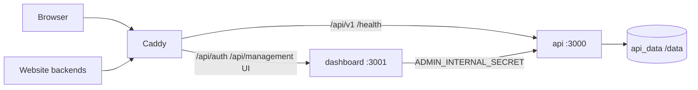

# Social Media Posts API

Self-hosted platform that fetches and normalizes recent **public** Facebook page posts and Instagram profile posts for your backends — with API-key auth, durable cache, shared Apify attempt controls, and a Next.js administration dashboard.

[](https://github.com/pitsssss/FB_-_IG_Scrapper_Tool/actions/workflows/ci.yml)


> GitHub repository name may still be historical (`Facebook_Scrapper_Tool` / `FB_-_IG_Scrapper_Tool`). The product name is **Social Media Posts API**. This project is licensed under **Apache License 2.0** — see [`LICENSE`](./LICENSE).

## Who it is for

Developers and operators who want a **private** posts API for websites and services, using **their own** Apify account (and optional Meta Graph tokens for pages they manage). Not a hosted SaaS and not affiliated with Meta.

## Features

| Area | What you get |
| --- | --- |
| Platforms | Facebook pages · Instagram profiles |
| Public API | `GET /api/v1/facebook/posts`, `GET /api/v1/instagram/posts` · `x-api-key` · stable JSON envelope |
| Dashboard | Setup/login · optional email OTP · TOTP MFA · Providers · API keys · Playground · Cache · Settings · Usage |
| Safety | Disk cache · stale-cache fallback · never wipe good cache on upstream failure · local daily Apify **attempt** budget |
| Deploy | Docker Compose: Caddy + API + Next.js · single API replica · SQLite management DB |

## Quick start (Docker — no host Node required)

```bash
git clone https://github.com/pitsssss/FB_-_IG_Scrapper_Tool.git
cd FB_-_IG_Scrapper_Tool

# Linux / macOS
chmod +x scripts/init-selfhost.sh
./scripts/init-selfhost.sh

# Windows PowerShell
#   .\scripts\init-selfhost.ps1

docker compose -f docker-compose.yml -f docker-compose.local.yml up -d --build
```

1. Open **http://127.0.0.1:8080/setup**
2. Paste `BOOTSTRAP_SETUP_TOKEN` from `.env`
3. Create the administrator
4. **Providers** → connect your Apify token
5. **API Keys** → create a key (copy once)
6. Call the API or use **Playground** (cache-only by default)

Production HTTPS: set `API_DOMAIN`, `ADMIN_ALLOWED_ORIGINS=https://your.domain`, `ADMIN_COOKIE_SECURE=1`, then `docker compose up -d --build`.

Full guide: [docs/SELF_HOSTING_GUIDE.md](docs/SELF_HOSTING_GUIDE.md) · Backup: [docs/BACKUP_RESTORE.md](docs/BACKUP_RESTORE.md)

## Architecture



Caddy must **not** send all `/api/*` to Node — BFF routes belong on the dashboard.

## Public API

```http
GET /health
GET /api/v1/facebook/posts?page=cern&limit=10
GET /api/v1/instagram/posts?page=nasa&limit=10
Header: x-api-key: <secret>
```

Bare usernames only (no profile URLs). Contract details: [docs/API_CONTRACT.md](docs/API_CONTRACT.md). Postman: `npm run postman:offline` (synthetic; zero Apify).

## Security model (summary)

- HttpOnly session cookies · CSRF + Origin allow-list · optional TOTP
- Apify tokens encrypted at rest (`DATA_ENCRYPTION_KEY`) · API keys hashed
- Management APIs require admin session; posts API requires `x-api-key`
- Report vulnerabilities privately — see [SECURITY.md](SECURITY.md)

## Local attempt quota ≠ Apify billing

`APIFY_DAILY_RUN_LIMIT` counts **local outbound Actor attempts**, not USD spent. Dashboard Usage is operational telemetry. Configure Apify billing in your Apify account.

## Limitations

- Live data depends on Apify (and optional Graph); cold misses can return `502`
- Instagram `stats.shares` is always `0`; carousel children often incomplete under `basicData`
- Not real-time guaranteed; cache TTL and upstream latency apply
- No claim of unlimited free scraping or Meta partnership
- Filesystem quota: **do not** scale multiple API replicas

## Development

```bash
npm test && npm run e2e && npm run postman:offline
npm run dashboard:lint && npm run dashboard:typecheck && npm run dashboard:test && npm run dashboard:build
npm run compose:smoke
```

Contributing: [CONTRIBUTING.md](CONTRIBUTING.md) · Production checklist: [docs/PRODUCTION_CHECKLIST.md](docs/PRODUCTION_CHECKLIST.md) · Release readiness: [docs/release/](docs/release/)

## License & support

This project is licensed under the [Apache License, Version 2.0](https://www.apache.org/licenses/LICENSE-2.0) (`Apache-2.0`). See the root [`LICENSE`](./LICENSE) file.

Under Apache-2.0:

- Personal and **commercial** use are permitted
- Modification and redistribution are permitted
- Integration into proprietary products is permitted without a general obligation to publish your modifications
- You must retain required license and attribution notices
- The software is provided **without warranties**, as described in the license

This project is independent and is **not** affiliated with, endorsed by, or sponsored by the Apache Software Foundation, Meta, Facebook, Instagram, or Apify.

Third-party dependency notes: [docs/release/THIRD_PARTY_LICENSE_INVENTORY.md](docs/release/THIRD_PARTY_LICENSE_INVENTORY.md). Publishing dashboard Docker images remains a separate compliance gate: [docs/release/DOCKER_THIRD_PARTY_COMPLIANCE.md](docs/release/DOCKER_THIRD_PARTY_COMPLIANCE.md).

**Platform terms are separate:** this code license does **not** grant Meta/Facebook/Instagram data access, Apify account rights, or remove provider obligations. Operators must comply with Apify and platform terms when using live providers.
