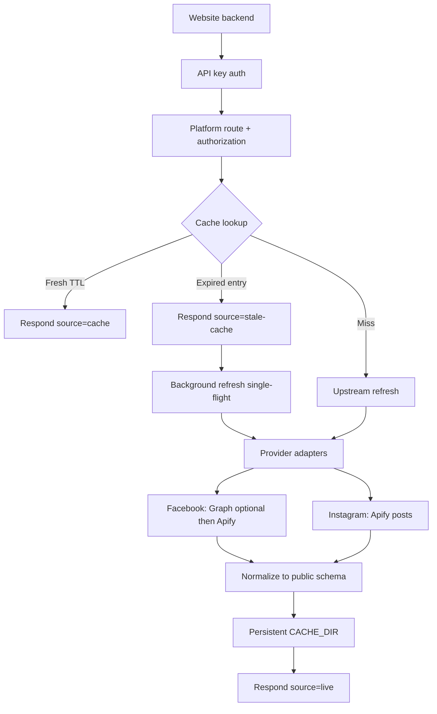

# Social Media Posts API

A standalone Node.js REST API that retrieves and normalizes recent **public** Facebook page posts and Instagram profile posts for backend clients—with API-key auth, persistent caching, shared Apify usage controls, and a stable JSON contract.

[](https://github.com/pitsssss/Facebook_Scrapper_Tool/actions/workflows/ci.yml)


> Repository name on GitHub remains `Facebook_Scrapper_Tool`. The product name is **Social Media Posts API**.

## Table of contents

- [Overview](#overview)
- [Features](#features)
- [Supported platforms](#supported-platforms)
- [Architecture](#architecture)
- [Quick start](#quick-start)
- [API reference](#api-reference)
- [Response format](#response-format)
- [Authentication & authorization](#authentication--authorization)
- [Providers](#providers)
- [Caching & reliability](#caching--reliability)
- [Apify usage & cost controls](#apify-usage--cost-controls)
- [Postman collection](#postman-collection)
- [Testing & quality](#testing--quality)
- [Configuration reference](#configuration-reference)
- [Docker & deployment](#docker--deployment)
- [Integration guide](#integration-guide)
- [Limitations](#limitations)
- [Troubleshooting](#troubleshooting)
- [Security](#security)
- [Project structure](#project-structure)
- [License & support](#license--support)

## Overview

Websites and backend services often need a small, consistent feed of recent social posts without embedding scraping logic in every app. This API centralizes that work:

- **Clients** (your PHP / Node / Next.js backends) call a single HTTP API with an API key.
- The API authenticates the client, checks page/profile authorization, serves **fresh cache** when possible, and refreshes from configured providers when needed.
- Responses use one **shared JSON schema** for Facebook and Instagram so UI code stays simple.

It is designed as a **separate service** (not a browser SDK): secrets stay on the server, quota is managed in one place, and multiple sites can share the same API with different keys and scopes.

## Features

| Category | Capabilities |
| --- | --- |
| **Platforms** | Facebook pages · Instagram profiles |
| **Data** | Account metadata (`id`, `name`, `logo`, `url`) · post text/permalinks · timestamps · image/video media · likes/comments/shares when available |
| **Access control** | Named API keys · optional per-client page/profile scopes · optional global allowlists · rate limiting |
| **Caching** | Disk + memory cache · fresh TTL · immediate **stale-cache** responses with background refresh · single-flight dedupe · optional cache warmer |
| **Reliability** | Never overwrite a good cache with empty/failed upstream · cooldown after failures · generic client errors |
| **Usage protection** | Shared Apify daily attempt budget · optional per-run `maxTotalChargeUsd` |
| **Development** | Zero runtime npm dependencies · Docker · Postman suite · unit/E2E/Newman tests · GitHub Actions CI |

Optional (code present; not all live-verified): Meta Graph for managed Facebook pages; Instagram profile-logo enrichment Actor (disabled by default).

## Supported platforms

| | Facebook | Instagram |
| --- | --- | --- |
| **Endpoint** | `GET /api/v1/facebook/posts` | `GET /api/v1/instagram/posts` |
| **`page` parameter** | Public Facebook **username** only | Public Instagram **username** only |
| **Default limit** | `MAX_POSTS` (default **10**) | Same |
| **Primary provider** | Apify `apify/facebook-posts-scraper` | Apify `apify/instagram-post-scraper` |
| **Optional provider** | Meta Graph API (`GRAPH_PAGE_TOKENS`) for pages you manage | Profile enrichment Actor (`INSTAGRAM_PROFILE_ENRICHMENT`, off by default) |
| **Auth** | Shared `x-api-key` / Bearer | Same |
| **Cache** | Platform-isolated keys (e.g. `cern`) | Keys like `instagram:nasa` |
| **`meta.provider`** | `apify` or `graph` | `instagram-apify` |
| **Known limits** | Graph needs real page tokens | `stats.shares` always `0`; pinned posts skipped by default; carousel children often incomplete under `basicData`; logo may be a documented fallback |

## Architecture



**Stale behavior (verified in `src/service.js`):** if a cache entry exists but is past `FRESH_TTL_SECONDS`, the API **returns that entry immediately** with `meta.source = "stale-cache"` and starts a background refresh (unless a recent failure cooldown is active). A cold miss with no cache returns `502 UPSTREAM_UNAVAILABLE` when providers fail.

## Quick start

**Requirements:** Node.js **≥ 20.6** (CI also runs on 22 and 24). No runtime `npm` packages; `newman` is a **devDependency** for Postman offline runs.

### A. Install

```bash
git clone https://github.com/pitsssss/Facebook_Scrapper_Tool.git
cd Facebook_Scrapper_Tool
npm install
```

### B. Configure

```bash
cp .env.example .env
```

PowerShell:

```powershell
Copy-Item .env.example .env
```

Minimum for a working API process:

| Variable | Notes |
| --- | --- |
| `API_KEYS` | Required. Format `name:secret` (comma-separated). Empty keys are rejected at startup. |
| `APIFY_TOKEN` | Required for **live** Facebook/Instagram Apify scrapes. Not required for `/health`, unit/e2e tests, or cache-only Postman serve. |
| `PORT` / `HOST` | Default `3000` / `0.0.0.0` in `.env.example`. |

Generate a local key:

```bash
node -e "console.log(require('crypto').randomBytes(24).toString('hex'))"
```

### C. Start the API

```bash
npm start
```

Production-style (env already injected by the host):

```bash
npm run start:prod
```

### D. Health check

```bash
curl http://127.0.0.1:3000/health
```

Expected: `{ "status": "ok" }`

### E. Sample posts request

Replace `YOUR_API_KEY` and ensure the page/profile is allowed by your scopes/allowlists:

```bash
curl -s "http://127.0.0.1:3000/api/v1/facebook/posts?page=cern&limit=10" ^
  -H "x-api-key: YOUR_API_KEY"
```

PowerShell:

```powershell
Invoke-RestMethod `
  -Uri "http://127.0.0.1:3000/api/v1/facebook/posts?page=cern&limit=10" `
  -Headers @{ "x-api-key" = "YOUR_API_KEY" }
```

**Postman cache-only server** (separate from `npm start`): `npm run postman:serve` starts a local API with `APIFY_DAILY_RUN_LIMIT=0`, writes a gitignored environment under `.postman-local/`, and serves already-cached pages only. See [Postman collection](#postman-collection).

## API reference

All data endpoints require authentication. Query parameter name is **`page`** on both platforms.

### `GET /health`

Liveness probe. No API key. Response: `{ "status": "ok" }`. Does **not** prove Apify, disk, or cache health.

### `GET /api/v1/facebook/posts`

| Query | Required | Description |
| --- | --- | --- |
| `page` | yes | Public Facebook **page username** only (e.g. `cern`). Full URLs → `400`. |
| `limit` | no | Clamped to `1..MAX_POSTS` (default `MAX_POSTS`, typically 10). Invalid values are clamped, not rejected. |

```http
GET /api/v1/facebook/posts?page=cern&limit=10 HTTP/1.1
Host: 127.0.0.1:3000
x-api-key: YOUR_API_KEY
```

### `GET /api/v1/instagram/posts`

| Query | Required | Description |
| --- | --- | --- |
| `page` | yes | Public Instagram **username** only (not a profile URL, not `@user`, not `/p/` or `/reel/`). |
| `limit` | no | Same clamping rules as Facebook. |

```http
GET /api/v1/instagram/posts?page=nasa&limit=10 HTTP/1.1
Host: 127.0.0.1:3000
x-api-key: YOUR_API_KEY
```

**Breaking change:** both endpoints previously accepted full social URLs in `page`. They now require **bare usernames** only. Full `https://…` inputs return `400 INVALID_PAGE_URL`. The server constructs canonical provider URLs internally.

Illustrative public demo usernames in the shareable Postman template:

- Facebook: `cern`
- Instagram: `nasa`

Replace with your authorized usernames. Port may differ when using `postman:serve` (generated `baseUrl`).

### Common HTTP statuses

| Status | Code | When |
| --- | --- | --- |
| 200 | — | Success envelope |
| 400 | `MISSING_PAGE` / `INVALID_PAGE_URL` | Missing or unsupported URL |
| 401 | `UNAUTHORIZED` | Missing/invalid API key |
| 403 | `PAGE_NOT_ALLOWED` | Outside allowlist or client scope |
| 404 | `NOT_FOUND` | Unknown route |
| 405 | `METHOD_NOT_ALLOWED` | Non-GET on data routes |
| 429 | `RATE_LIMITED` | Per-client rate window exceeded (`Retry-After`) |
| 502 | `UPSTREAM_UNAVAILABLE` | No usable cache and upstream blocked/failed |
| 500 | `INTERNAL_ERROR` | Unexpected server error |

Full contract notes: [`docs/API_CONTRACT.md`](docs/API_CONTRACT.md).

## Response format

Facebook and Instagram share the same public envelope.

### Success (illustrative shape)

Field names and nesting match the implementation. Values below are **examples**, not a live scrape dump.

```json
{
  "success": true,
  "data": {
    "page": {
      "id": "100064792144187",
      "name": "Example Page",
      "logo": "https://example.invalid/logo.jpg",
      "logo_fallback": "https://graph.facebook.com/example/picture?type=large",
      "url": "https://www.facebook.com/cern"
    },
    "posts": [
      {
        "id": "1565287548974302",
        "url": "https://www.facebook.com/cern/posts/1",
        "text": "",
        "created_at": "2026-11-02T08:33:27.000Z",
        "image": "https://example.invalid/image.jpg",
        "media": [
          { "type": "image", "url": "https://example.invalid/image.jpg", "thumbnail": null }
        ],
        "stats": { "likes": 4, "comments": 0, "shares": 0 },
        "page": {
          "id": "100064792144187",
          "name": "Example Page",
          "logo": "https://example.invalid/logo.jpg",
          "logo_fallback": "https://graph.facebook.com/example/picture?type=large",
          "url": "https://www.facebook.com/cern"
        }
      }
    ]
  },
  "meta": {
    "source": "cache",
    "provider": "apify",
    "fetched_at": "2026-11-02T12:00:00.000Z",
    "cache_age_seconds": 12,
    "stale": false,
    "count": 1,
    "limit": 10,
    "warning": null
  }
}
```

| `meta.source` | Meaning |
| --- | --- |
| `live` | Just refreshed from a provider |
| `cache` | Served within fresh TTL |
| `stale-cache` | Served expired cache; refresh may be in background |

| `meta.provider` | Typical origin |
| --- | --- |
| `apify` | Facebook Apify Actor |
| `graph` | Meta Graph |
| `instagram-apify` | Instagram post Actor |

Notes:

- `meta.count` equals `data.posts.length` and is ≤ `meta.limit`.
- Empty `text` with media is valid.
- Instagram `stats.shares` is normalized to `0` (Actor does not provide shares)—not a verified “zero shares” metric.
- Instagram `page.logo_fallback` is a documented generic placeholder URL when no real photo is available.
- `meta.warning` may be `"UPSTREAM_REFRESH_FAILED"` on non-live responses after a failed refresh attempt.

### Error envelope

```json
{
  "success": false,
  "error": {
    "code": "UPSTREAM_UNAVAILABLE",
    "message": "Could not fetch posts from any provider and no cached copy exists"
  }
}
```

## Authentication & authorization

**Authentication** proves who the client is. **Authorization** decides which pages/profiles that client may request.

| Header | Purpose |
| --- | --- |
| `x-api-key: <secret>` | Preferred |
| `Authorization: Bearer <secret>` | Also accepted |

Credentials are **never** taken from query strings.

| Config | Role |
| --- | --- |
| `API_KEYS` | `name:secret` pairs (required) |
| `API_KEY_PAGE_SCOPES` | Optional JSON map of client name → allowed Facebook/Instagram URLs |
| `ALLOWED_PAGES` | Optional global Facebook allowlist (slugs/ids) |
| `INSTAGRAM_ALLOWED_PROFILES` | Optional global Instagram allowlist |
| `RATE_LIMIT_PER_MIN` | Per-client limit (default `120`; `0` disables) |

When `API_KEY_PAGE_SCOPES` is set, **every** `API_KEYS` name must have an array entry. Facebook slug and numeric id are **not** auto-equated. Instagram keys are `instagram:<username>`.

Keep API keys on **your backend only**. Do not put them in browsers, mobile apps, or `NEXT_PUBLIC_*` variables.

## Providers

Configured via `PROVIDERS` (default `graph,apify`). For each name:

1. **`graph`** — Facebook only, when `GRAPH_PAGE_TOKENS` contains a token for that page.
2. **`apify`** — registers both Facebook Apify **and** Instagram Apify adapters that share one quota manager.

| Provider | Token | Live acceptance notes |
| --- | --- | --- |
| Facebook Apify | `APIFY_TOKEN` | Used in controlled local live/Postman runs |
| Meta Graph | `GRAPH_PAGE_TOKENS` | Optional; requires pages you manage—do not assume live-tested for every deploy |
| Instagram posts Apify | same `APIFY_TOKEN` | Covered by controlled provider integration testing against a public demo profile; other profiles are not assumed warm |
| Instagram profile Actor | same token + shared quota | Optional; **disabled** unless `INSTAGRAM_PROFILE_ENRICHMENT=1`; not treated as live-verified here |

Unavailable providers are skipped; if all fail and no cache exists → `502`. Good caches are never replaced with empty/failed results.

## Caching & reliability

| Setting | Default (from config / `.env.example`) | Role |
| --- | --- | --- |
| `CACHE_DIR` | `./data/cache` (Docker: `/data/cache`) | Posts + `apify-quota.json` (+ optional IG profile meta) |
| `FRESH_TTL_SECONDS` | `21600` (6h) | Fresh → `source=cache` |
| `RETRY_COOLDOWN_SECONDS` | `300` | Delay before retrying a failed page/profile |
| `WARM_PAGES` / `INSTAGRAM_WARM_PROFILES` | empty | Optional background warming (disabled when empty) |

Also:

- Concurrent identical refreshes share one in-flight promise (single-flight).
- Cache files are platform-isolated.
- Ephemeral disks lose cache and quota state on restart—attach a durable volume in production.
- Social CDN URLs in `logo` / `image` / `media` can expire; use `logo_fallback` / UI `onerror` where appropriate.

## Apify usage & cost controls

Facebook and Instagram Actors share:

- One `APIFY_TOKEN`
- One filesystem counter: `CACHE_DIR/apify-quota.json`
- One daily attempt budget: `APIFY_DAILY_RUN_LIMIT` (default **12**; **`0` = cache-only**)

| Variable | Meaning |
| --- | --- |
| `APIFY_DAILY_RUN_LIMIT` | Max outbound Apify **run-sync attempts** this process may start per UTC day (success **and** failure). Cache hits do not count. |
| `APIFY_MAX_CHARGE_USD_PER_RUN` | Optional Apify query param `maxTotalChargeUsd` for a **single** run. Empty = omit. |

Inspect without mutating: `npm run quota:status`.

This local counter is **not** a substitute for Apify’s billing dashboard. Actor pricing changes over time—see [Apify pricing](https://apify.com/pricing). Failed attempts, retries, and optional profile enrichment can consume budget. Prefer cache-only inspection; use live scrapes intentionally.

**Production note:** filesystem quota assumes a **single API replica**. Multi-replica safety is not implemented.

## Postman collection

Unified Collection v2.1 (Facebook + Instagram):

| File | Purpose |
| --- | --- |
| [`postman/Social-Media-Posts-API.postman_collection.json`](postman/Social-Media-Posts-API.postman_collection.json) | Importable suite |
| [`postman/Social-Media-Posts-Local.postman_environment.json`](postman/Social-Media-Posts-Local.postman_environment.json) | Shareable template (empty `apiKey`) |
| `.postman-local/Social-Media-Posts-Local.generated.postman_environment.json` | Created by serve (gitignored; contains a local test key) |

### Desktop (cache-only)

```bash
npm run postman:serve
```

1. Import the collection JSON.  
2. Import the **generated** environment.  
3. Select **Social Media Posts API — Local Generated**.  
4. Open `01 — Facebook` → `FB — 02 Real Posts` → **Get Latest 10 Facebook Posts**.  
5. Open `02 — Instagram` → `IG — 02 Real Posts` → **Get Latest 10 Instagram Posts**.

Pre-filled variables: `facebookUsername=cern`, `instagramUsername=nasa`, `limit=10`; `baseUrl` and `apiKey` filled by serve. Optional private overrides: `POSTMAN_FACEBOOK_USERNAME`, `POSTMAN_INSTAGRAM_USERNAME` (runtime only).

Do **not** commit or sync the generated environment to a shared Postman cloud workspace.

### Safety

| Mode | Command | Apify cost |
| --- | --- | --- |
| Offline synthetic | `npm run postman:offline` | None (fake upstream) |
| Cache-only Desktop | `npm run postman:serve` | None for uncached (returns `502`) |
| Controlled live | `postman:live` / `postman:instagram:live` / `serve -- --live` | Explicit paid path |

**Do not “Run Collection” against a live Apify token.** Offline Resilience folders inject failures; Real Posts can scrape when cache is cold.

Details: [`postman/README.md`](postman/README.md).

## Testing & quality

| Command | What it covers |
| --- | --- |
| `npm test` | Unit/integration tests (Node test runner; no real Apify) |
| `npm run e2e` | Local E2E with fake upstream |
| `npm run postman:offline` | Newman against the unified collection (fake upstream) |

CI: [`.github/workflows/ci.yml`](.github/workflows/ci.yml) runs `npm test`, `npm run e2e`, and a Docker smoke job on push/PR (Ubuntu + Windows; Node 22/24). Local green results are not a perpetual production guarantee.

Regenerate Postman artifacts: `npm run postman:collection`.

## Configuration reference

Authoritative full list: [`.env.example`](.env.example). Essentials:

| Variable | Required | Default / example | Notes |
| --- | --- | --- | --- |
| `PORT` | no | `3000` | Host may override |
| `HOST` | no | `0.0.0.0` | |
| `API_KEYS` | **yes** | `site1:CHANGE_ME_1` | `name:key` list |
| `API_KEY_PAGE_SCOPES` | no | empty | JSON scopes |
| `ALLOWED_PAGES` | no | empty | Facebook only |
| `INSTAGRAM_ALLOWED_PROFILES` | no | empty | Instagram only |
| `ALLOWED_ORIGINS` | no | empty | CORS; prefer empty for server-to-server |
| `RATE_LIMIT_PER_MIN` | no | `120` | `0` disables |
| `CACHE_DIR` | no | `./data/cache` | Durable volume in prod |
| `FRESH_TTL_SECONDS` | no | `21600` | |
| `MAX_POSTS` | no | `10` | Max/default limit |
| `PROVIDERS` | no | `graph,apify` | Order matters |
| `APIFY_TOKEN` | for live scrapes | empty | Shared FB+IG |
| `APIFY_DAILY_RUN_LIMIT` | no | `12` | `0` = cache-only |
| `APIFY_MAX_CHARGE_USD_PER_RUN` | no | empty | Per-run USD cap query param |
| `INSTAGRAM_APIFY_ACTOR` | no | `apify~instagram-post-scraper` | |
| `INSTAGRAM_PROFILE_ENRICHMENT` | no | `0` | Paid optional |
| `GRAPH_PAGE_TOKENS` | no | empty | Managed pages only |
| `WARM_PAGES` / `INSTAGRAM_WARM_PROFILES` | no | empty | Warming off when empty |

## Docker & deployment

```dockerfile
# Image listens on PORT (default 3000), CACHE_DIR=/data/cache, USER node
```

```bash
docker build -t fb-posts-api .
docker run -d -p 3000:3000 -v fbdata:/data --env-file .env fb-posts-api
```

[`docker-compose.yml`](docker-compose.yml) runs a **single** `api` replica plus optional Caddy TLS. Mount `/data` so posts cache and `apify-quota.json` survive restarts.

Checklist: [`docs/PRODUCTION_CHECKLIST.md`](docs/PRODUCTION_CHECKLIST.md).

This repository does **not** document a public production URL. Deploy on any host that provides Node/Docker, HTTPS termination, and durable storage—then call the API from your website backends.

## Integration guide

```text
Website frontend  →  Your backend  →  Social Media Posts API  →  Cache / providers
```

Recommended pattern (server-to-server):

```js
const url = new URL(`${API_BASE}/api/v1/facebook/posts`);
url.searchParams.set('page', process.env.YOUR_FACEBOOK_USERNAME || 'cern');
url.searchParams.set('limit', '10');

const res = await fetch(url, {
  headers: { 'x-api-key': process.env.SOCIAL_POSTS_API_KEY },
  signal: AbortSignal.timeout(100_000),
});
const body = await res.json();
if (!body.success) {
  // keep previous UI state; do not blank the section
  throw new Error(body.error?.code || 'request_failed');
}
```

Examples in-repo:

- [`examples/README.md`](examples/README.md) — security and multi-site notes  
- [`examples/php/`](examples/php/)  
- [`examples/nextjs-app-router/`](examples/nextjs-app-router/)

Handle empty captions, stale-cache, and media URL expiry in your UI. Link out to original post permalinks with `rel="noopener noreferrer"` where appropriate.

## Limitations

1. Public pages/profiles only—private content is out of scope.  
2. Upstream Actors and Graph can change or fail without notice.  
3. Fewer than 10 posts may be returned; exact-10 is not guaranteed.  
4. Instagram defaults skip pinned posts (`skipPinnedPosts=true`).  
5. Instagram logos may be a generic fallback unless posts/config/enrichment provide a real HTTPS image.  
6. Profile enrichment is optional and not assumed live-verified.  
7. Instagram `basicData` Sidecar items often omit carousel children (cover only).  
8. CDN media URLs expire.  
9. Engagement fields may be zero when hidden/unavailable.  
10. Scraping public pages may conflict with platform terms—use Graph for pages you own when possible.  
11. Apify usage is billed by Apify; this app only tracks local attempt budgets.  
12. Durable `CACHE_DIR` is required for cache/quota survival.  
13. Filesystem quota is single-replica.  
14. Offline/synthetic tests ≠ continuous live monitoring.  
15. Public demo defaults are illustrative; a cold cache plus cache-only mode returns `502` until an intentional live seed exists.

## Troubleshooting

| Symptom | Likely cause | What to check |
| --- | --- | --- |
| `401 UNAUTHORIZED` | Missing/wrong key | `x-api-key` / Bearer; `API_KEYS` |
| `403 PAGE_NOT_ALLOWED` | Scope/allowlist | `API_KEY_PAGE_SCOPES`, `ALLOWED_PAGES`, `INSTAGRAM_ALLOWED_PROFILES` |
| `400 INVALID_PAGE_URL` | Wrong URL type | Page URL vs post/reel/group URL |
| `429 RATE_LIMITED` | Client rate window | `RATE_LIMIT_PER_MIN`; honor `Retry-After` |
| `502 UPSTREAM_UNAVAILABLE` | Cold cache + no upstream | Token, quota (`npm run quota:status`), cache-only mode |
| Postman auth fails | Stale generated env | Re-run `npm run postman:serve` and re-import env |
| Broken images | Expired CDN URL | Use `logo_fallback` / placeholders |
| Quota never moves in cache-only | Expected | `APIFY_DAILY_RUN_LIMIT=0` blocks Apify |
| Disk errors / empty after restart | Ephemeral volume | Persist `CACHE_DIR` |

## Security

- Store `API_KEYS` and `APIFY_TOKEN` in environment/secrets managers—never in Git.  
- Prefer server-to-server calls; leave `ALLOWED_ORIGINS` empty unless browsers must call the API.  
- Use page/profile scopes to limit blast radius per client.  
- Rate limiting reduces accidental abuse; it is not a WAF.  
- Client error messages are generic (no token leakage).  
- Restrict filesystem permissions on `CACHE_DIR`.  
- Respect applicable laws and platform policies when fetching public content.  

No external security audit or compliance certification is claimed.

## Project structure

```text
├── src/                 # HTTP server, service, cache, quota, normalizers
│   └── providers/       # Apify (FB/IG), Graph, optional IG profile Actor
├── apps/dashboard/      # Next.js admin UI foundation (Phase 7B — local preview only)
├── test/                # Unit / integration tests
├── scripts/             # E2E, Postman runner, quota status, Docker smoke
├── postman/             # Unified collection + env template
├── docs/                # API contract, production checklist, product architecture
├── examples/            # PHP / Next.js integration sketches
├── .github/workflows/   # CI
├── Dockerfile
├── docker-compose.yml
├── .env.example
└── package.json
```

> **Dashboard status:** `apps/dashboard` is a UI foundation for the future self-hosted admin experience. It is **not** production-ready and must not be exposed publicly until Phase 7C authentication. See [`apps/dashboard/README.md`](apps/dashboard/README.md) and [`docs/product/`](docs/product/).

## License & support

No `LICENSE` file is present in this repository at the time of writing—do not assume MIT or any other license unless the owner adds one.

There is no `CONTRIBUTING.md`. Use [GitHub Issues](https://github.com/pitsssss/Facebook_Scrapper_Tool/issues) on the repository if Issues are enabled for bug reports.

---

**Related docs:** [`docs/API_CONTRACT.md`](docs/API_CONTRACT.md) · [`docs/PRODUCTION_CHECKLIST.md`](docs/PRODUCTION_CHECKLIST.md) · [`postman/README.md`](postman/README.md) · [`examples/README.md`](examples/README.md)
