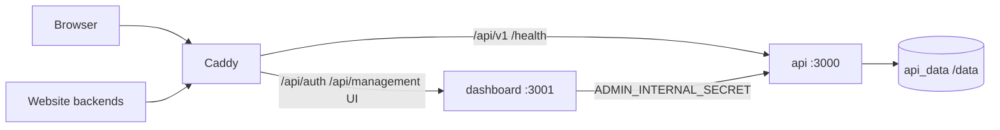
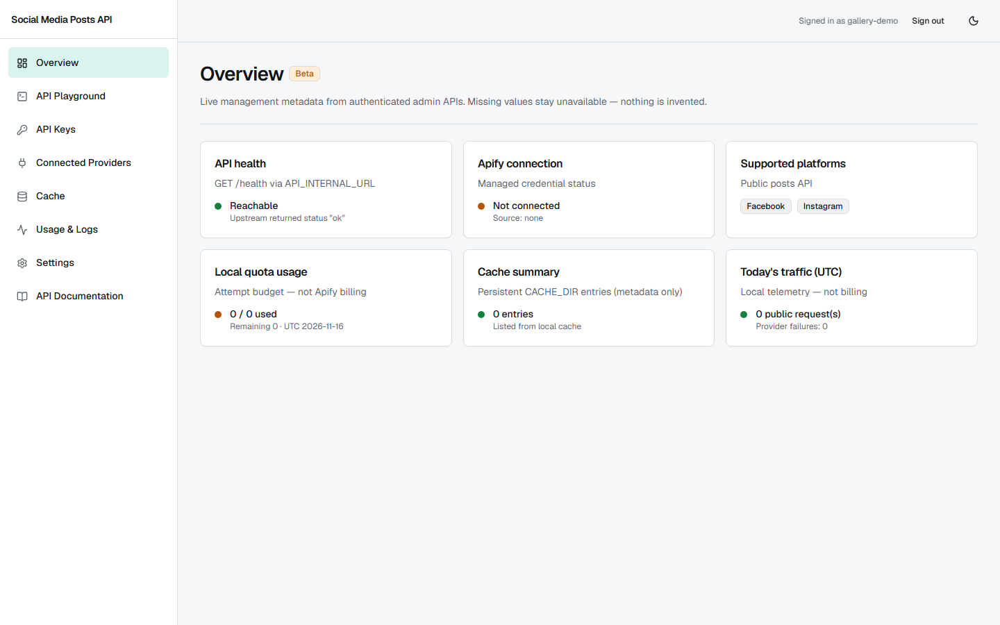
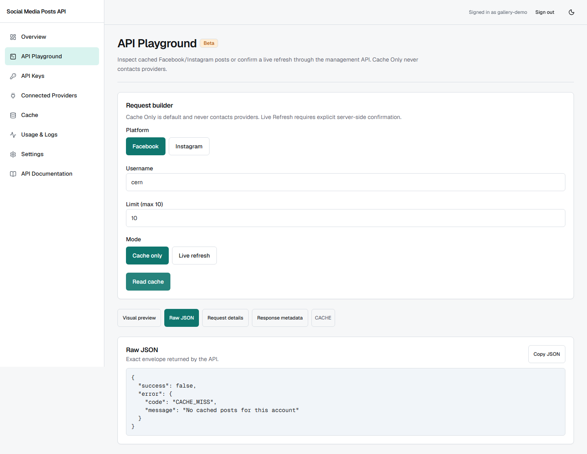
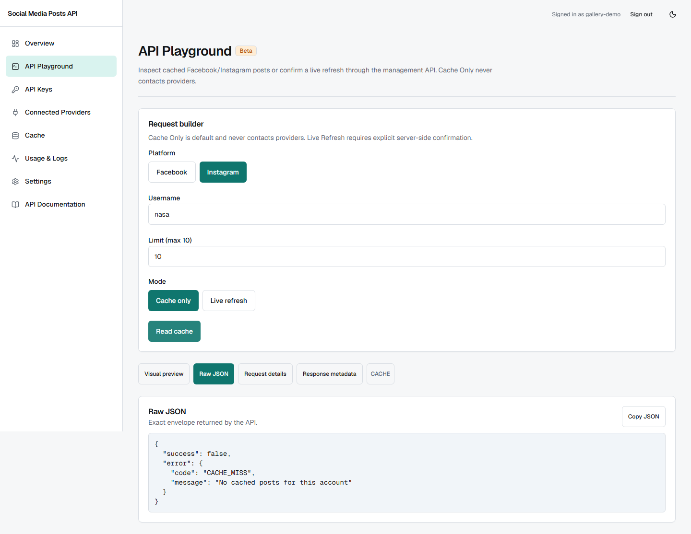
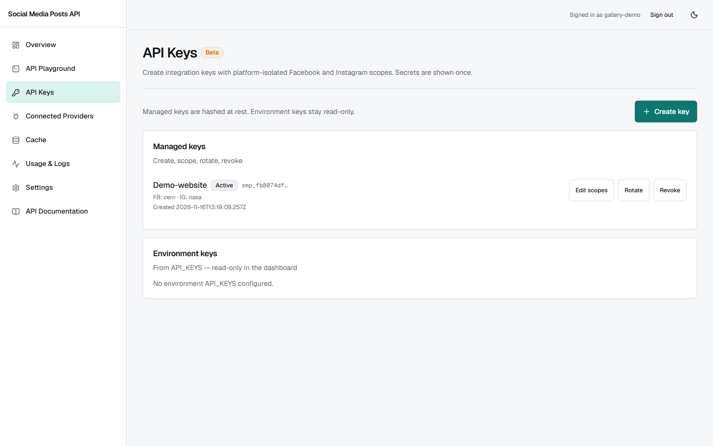
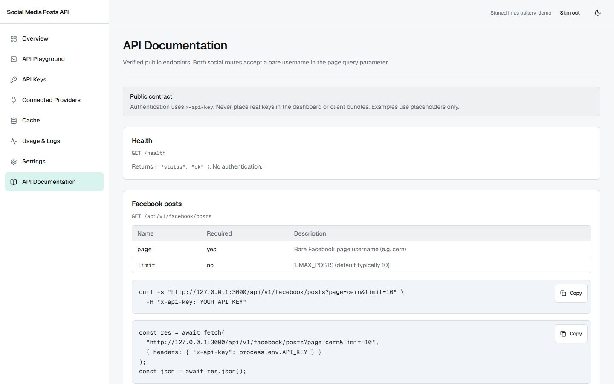
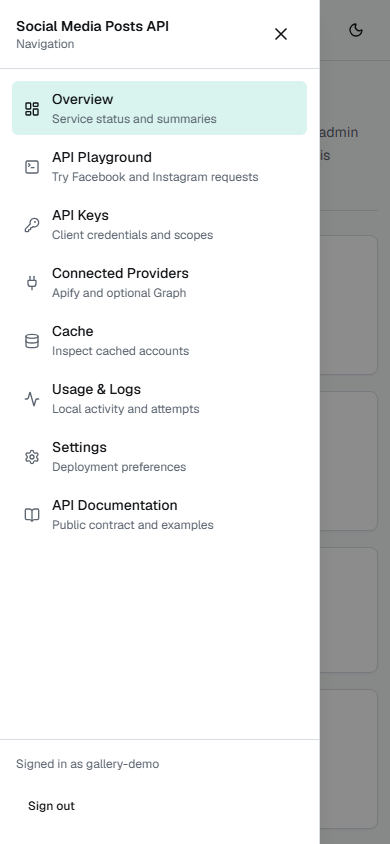

# Social Media Posts API

Self-hosted **Facebook** and **Instagram** posts API with a Next.js administration dashboard, scoped API keys, durable caching, and Docker deployment.

[](https://github.com/pitsssss/FB_-_IG_Scrapper_Tool/actions/workflows/ci.yml)
[](https://github.com/pitsssss/FB_-_IG_Scrapper_Tool/releases/tag/v0.1.0-beta.1)
[](./LICENSE)

> **Public beta:** [`v0.1.0-beta.1`](https://github.com/pitsssss/FB_-_IG_Scrapper_Tool/releases/tag/v0.1.0-beta.1) (pre-release). Experimental — not production-stable.
> GitHub repository name may still be historical (`FB_-_IG_Scrapper_Tool`). The product name is **Social Media Posts API**.

## What it does

Operators run a private API that returns recent **public** Facebook page posts and Instagram profile posts as a stable JSON envelope for websites and backends. Live fetches use **your** Apify account (optional Meta Graph tokens for Pages you manage). Cache hits do not call Apify.

This project is **not** a hosted SaaS and is **not** affiliated with Meta, Facebook, Instagram, or Apify.

## Features

| Area | Details |
| --- | --- |
| Platforms | Public Facebook pages · public Instagram profiles |
| Public API | `GET /api/v1/facebook/posts`, `GET /api/v1/instagram/posts` · `x-api-key` · stable JSON envelope |
| Auth | Scoped API keys · admin bootstrap · optional email OTP · optional TOTP MFA |
| Dashboard | Providers · API keys · Playground · Cache · Settings · Usage & Logs · Docs |
| Safety | Disk cache · stale-cache fallback · never overwrite good cache with empty/failed results · local Apify **attempt** limit |
| Deploy | Docker Compose: Caddy + API + dashboard · published GHCR images (linux/amd64) · single API replica |

## Architecture



Caddy must **not** route all `/api/*` to the API — BFF routes belong on the dashboard.

## Quick start

Two supported paths:

| Path | When to use | Entry |
| --- | --- | --- |
| **A — Build from source** | Local loopback HTTP on `127.0.0.1:8080` | `docker-compose.yml` + `docker-compose.local.yml` |
| **B — Published images** | Production-style HTTPS with digest-pinned GHCR images | `docker-compose.release.yml` (ports **80/443**, requires domain + secrets) |

Path B is **not** a drop-in localhost:8080 installer. For local learning, prefer Path A.

### Option A — Build from source (loopback HTTP)

**Linux / macOS**

```bash
git clone https://github.com/pitsssss/FB_-_IG_Scrapper_Tool.git
cd FB_-_IG_Scrapper_Tool
git checkout v0.1.0-beta.1
chmod +x scripts/init-selfhost.sh
./scripts/init-selfhost.sh
docker compose -f docker-compose.yml -f docker-compose.local.yml up -d --build
```

**Windows PowerShell**

```powershell
git clone https://github.com/pitsssss/FB_-_IG_Scrapper_Tool.git
cd FB_-_IG_Scrapper_Tool
git checkout v0.1.0-beta.1
.\scripts\init-selfhost.ps1
docker compose -f docker-compose.yml -f docker-compose.local.yml up -d --build
```

1. Open **http://127.0.0.1:8080/setup**
2. Paste `BOOTSTRAP_SETUP_TOKEN` from `.env`
3. Create your administrator
4. **API Keys** → create a key (copy once)
5. Optionally connect Apify under **Providers** (live fetches can incur Apify costs)

Cost-safe first boot: leave `APIFY_TOKEN` empty and keep `APIFY_DAILY_RUN_LIMIT=0` (or run `scripts/apply-beta-safe-defaults.* -Confirm` / `--confirm` on a **fresh** tester `.env` only).

### Option B — Published GHCR images (linux/amd64)

Packages:

- [social-media-posts-api](https://github.com/pitsssss/FB_-_IG_Scrapper_Tool/pkgs/container/social-media-posts-api)
- [social-media-posts-dashboard](https://github.com/pitsssss/FB_-_IG_Scrapper_Tool/pkgs/container/social-media-posts-dashboard)

**Immutable digests (verified):**

```text
ghcr.io/pitsssss/social-media-posts-api@sha256:c57bdb5dab3250eafd557e9bb596a46eb8e5096b70ad787abe5128cc573a8903
ghcr.io/pitsssss/social-media-posts-dashboard@sha256:90acd28bd9078c56e78eed15e307fe5bbc730f7cd9d54a1166251bc3b02ec182
```

Floating tags (same builds): `…:0.1.0-beta.1` — prefer digests for operators.

```bash
git clone https://github.com/pitsssss/FB_-_IG_Scrapper_Tool.git
cd FB_-_IG_Scrapper_Tool
git checkout v0.1.0-beta.1
# Generate .env secrets (init-selfhost), then set production values:
#   API_DOMAIN=your.domain
#   ADMIN_ALLOWED_ORIGINS=https://your.domain
#   ADMIN_COOKIE_SECURE=1
#   TRUST_PROXY=1
#   SMP_API_IMAGE / SMP_DASHBOARD_IMAGE to the digests above
export SMP_API_IMAGE='ghcr.io/pitsssss/social-media-posts-api@sha256:c57bdb5dab3250eafd557e9bb596a46eb8e5096b70ad787abe5128cc573a8903'
export SMP_DASHBOARD_IMAGE='ghcr.io/pitsssss/social-media-posts-dashboard@sha256:90acd28bd9078c56e78eed15e307fe5bbc730f7cd9d54a1166251bc3b02ec182'
docker compose --env-file .env -f docker-compose.release.yml up -d
```

Required by Compose: `SMP_API_IMAGE`, `SMP_DASHBOARD_IMAGE`, `ADMIN_INTERNAL_SECRET`, `ADMIN_ALLOWED_ORIGINS`, `API_DOMAIN` (see `docker-compose.release.yml`). DNS must point at the host for automatic HTTPS via Caddy.

Full guide: [docs/SELF_HOSTING_GUIDE.md](docs/SELF_HOSTING_GUIDE.md) · Release notes: [v0.1.0-beta.1](https://github.com/pitsssss/FB_-_IG_Scrapper_Tool/releases/tag/v0.1.0-beta.1)

## Public API examples

```http
GET /health
GET /api/v1/facebook/posts?page=cern&limit=10
GET /api/v1/instagram/posts?page=nasa&limit=10
Header: x-api-key: <secret>
```

Bare usernames only (no profile URLs). Contract: [docs/API_CONTRACT.md](docs/API_CONTRACT.md). Offline Postman: `npm run postman:offline` (synthetic; zero Apify).

## Dashboard

After setup/login: Overview, Providers, API Keys, Playground (cache-only by default), Cache, Settings, Usage & Logs, and in-app API documentation. Responsive layouts cover mobile, tablet, and desktop.

## Dashboard Preview

Screenshots captured from the actual application using isolated demonstration data. No live Apify requests were made. Empty and cache-miss states are intentional — not live scrape results.

<p align="center">
  
</p>

<p align="center">
  
  &nbsp;
  
</p>

<p align="center">
  
  &nbsp;
  
</p>

<p align="center">
  
</p>

Full gallery (11 views, including providers, cache, usage, settings, and tablet): [docs/assets/screenshots/GALLERY_PREVIEW.md](docs/assets/screenshots/GALLERY_PREVIEW.md).

## Security and Apify cost safeguards

- HttpOnly session cookies · CSRF + Origin allow-list · optional TOTP
- Apify tokens encrypted at rest (`DATA_ENCRYPTION_KEY`) · API keys hashed
- `APIFY_DAILY_RUN_LIMIT` counts **local outbound Actor attempts**, not USD spent
- Live Apify runs can incur charges on **your** Apify account — leave the token empty until you opt in
- Report vulnerabilities privately: [SECURITY.md](SECURITY.md)

## Documentation

| Doc | Purpose |
| --- | --- |
| [docs/SELF_HOSTING_GUIDE.md](docs/SELF_HOSTING_GUIDE.md) | Self-host install |
| [docs/API_CONTRACT.md](docs/API_CONTRACT.md) | Public API contract |
| [docs/BACKUP_RESTORE.md](docs/BACKUP_RESTORE.md) | Management DB backup |
| [docs/PRODUCTION_CHECKLIST.md](docs/PRODUCTION_CHECKLIST.md) | Production hardening |
| [docs/release/](docs/release/) | Release notes, compliance, decisions |
| [docs/beta/](docs/beta/) | Invited-tester materials (historical program; owner skipped invitations) |
| [CONTRIBUTING.md](CONTRIBUTING.md) | Development and PR expectations |

## Known limitations

- Experimental **beta** — no production SLA
- Provider success is not guaranteed; Meta/Apify availability and terms apply
- Empty cache + disabled/unavailable upstream → structured errors (often `502`)
- Instagram `stats.shares` is always `0`; carousel children often incomplete under `basicData`
- Published images: **linux/amd64** only for this beta
- Filesystem quota: **do not** run multiple API replicas
- Independent external tester invitations were **skipped** by owner decision — see [BETA_PUBLICATION_EXCEPTION.md](docs/release/BETA_PUBLICATION_EXCEPTION.md)

## Development

```bash
npm test && npm run e2e && npm run postman:offline
npm run dashboard:lint && npm run dashboard:typecheck && npm run dashboard:test && npm run dashboard:build
npm run compose:smoke
npm run release:image-smoke   # requires local or published images
```

## Contributing

See [CONTRIBUTING.md](CONTRIBUTING.md). Please open issues for bugs and docs; security reports go through [SECURITY.md](SECURITY.md) (private advisories).

## License

[Apache License 2.0](./LICENSE). Third-party notes: [THIRD_PARTY_LICENSE_INVENTORY.md](docs/release/THIRD_PARTY_LICENSE_INVENTORY.md). Dashboard image LGPL materials: [DOCKER_THIRD_PARTY_COMPLIANCE.md](docs/release/DOCKER_THIRD_PARTY_COMPLIANCE.md).

This project is independent and is **not** affiliated with, endorsed by, or sponsored by the Apache Software Foundation, Meta, Facebook, Instagram, or Apify. The code license does **not** grant platform data access or Apify account rights.
