# Dashboard Screenshot Gallery

Screenshots captured from the **actual** Social Media Posts API Next.js dashboard using an **isolated demonstration** environment.

> Screenshots captured from the actual application using isolated demonstration data. No live Apify requests were made.

- Synthetic administrator: `gallery-demo`
- No real Apify token · `APIFY_DAILY_RUN_LIMIT=0` · Cache Only playground reads only
- Empty / cache-miss states are intentional — **not** live Facebook or Instagram scrape results
- Product version context: public beta [`v0.1.0-beta.1`](https://github.com/pitsssss/FB_-_IG_Scrapper_Tool/releases/tag/v0.1.0-beta.1)

---

## 1. Dashboard Overview

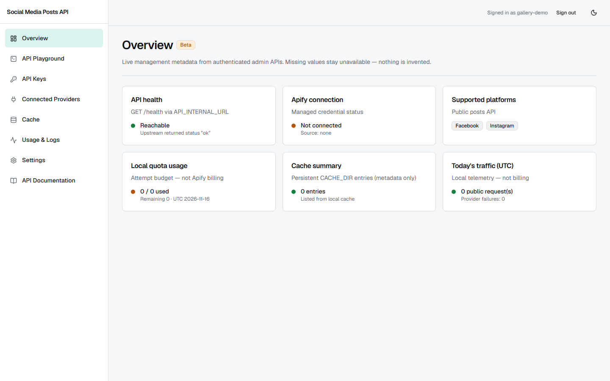

**Overview** summarizes API health, Apify connection status, supported platforms, local attempt quota, cache entry count, and today’s traffic. In this demo capture Apify is honestly **Not connected** and counters are empty.

---

## 2. Facebook & Instagram API Playground

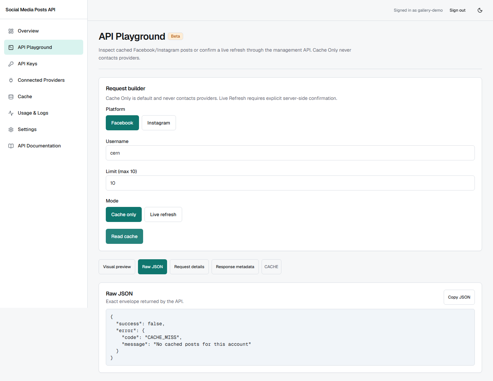

**Facebook Playground** — platform Facebook, username `cern`, **Cache only** mode. The Raw JSON panel shows a real `CACHE_MISS` envelope (`success: false`). This is **not** retrieved social posts and was **not** a Live Refresh.

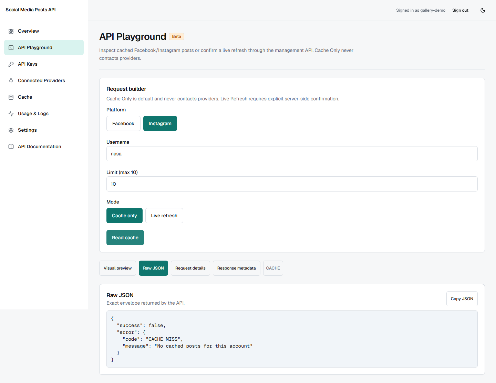

**Instagram Playground** — platform Instagram, username `nasa`, **Cache only** mode, with the same honest cache-miss JSON response. No Apify Actor was invoked.

---

## 3. API Key Management

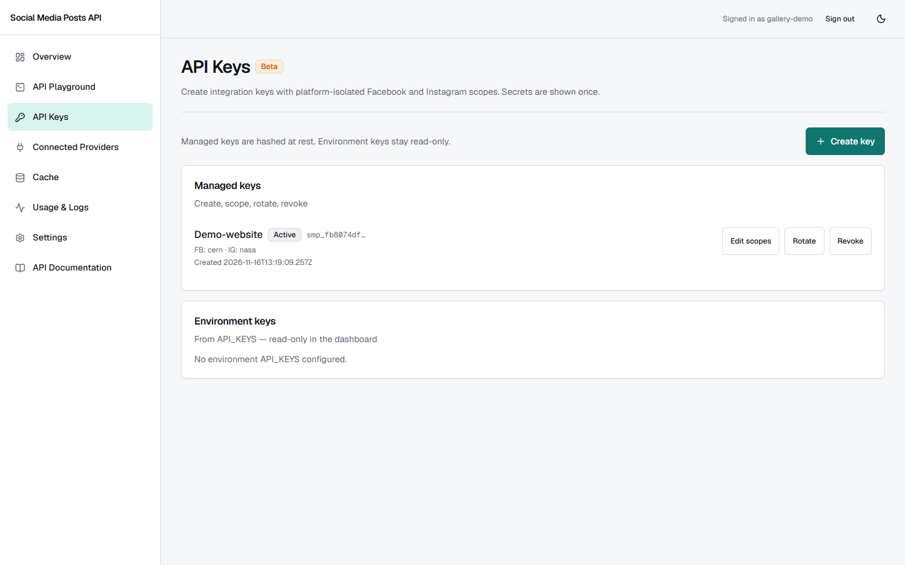

**API Keys** lists managed integration clients with platform-isolated Facebook and Instagram scopes. The demo key `Demo-website` shows only a **truncated non-secret prefix** (`smp_…`). Full secrets are never stored in screenshots.

---

## 4. Cache Management

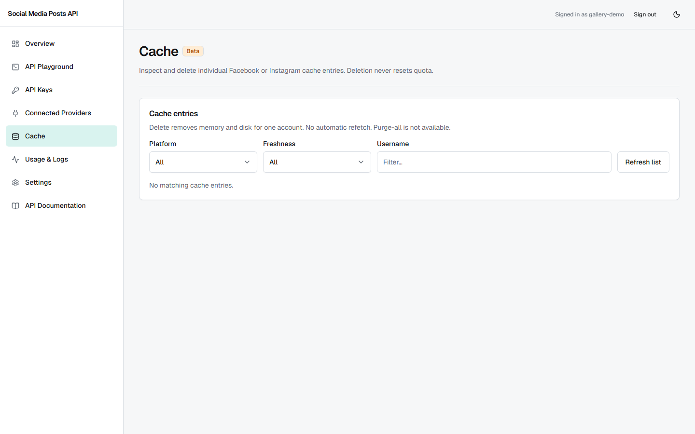

**Cache** lets operators filter by platform and freshness and delete individual account entries. This demo environment has **no matching cache entries**.

---

## 5. Connected Providers

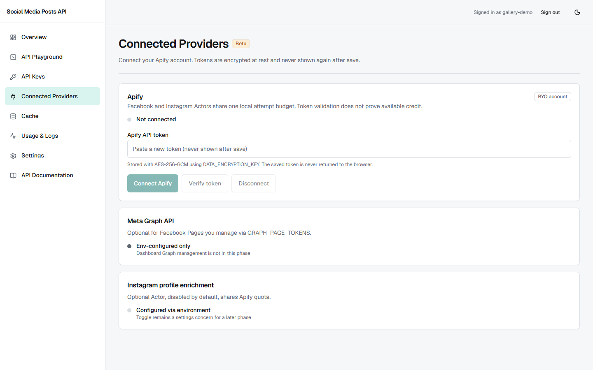

**Connected Providers** manages the bring-your-own Apify token (encrypted at rest). The demo stack shows the real **Not connected** state — connection success is never faked.

---

## 6. Usage & Logs

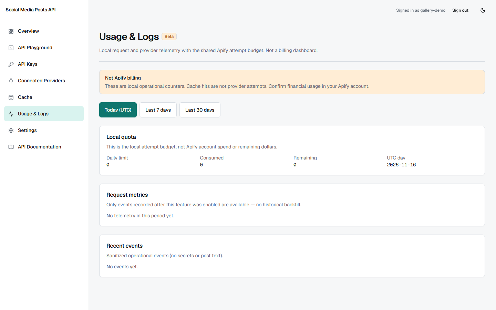

**Usage & Logs** shows local operational counters and sanitized events (not Apify billing). With the demo daily limit set to `0`, telemetry remains empty.

---

## 7. Settings

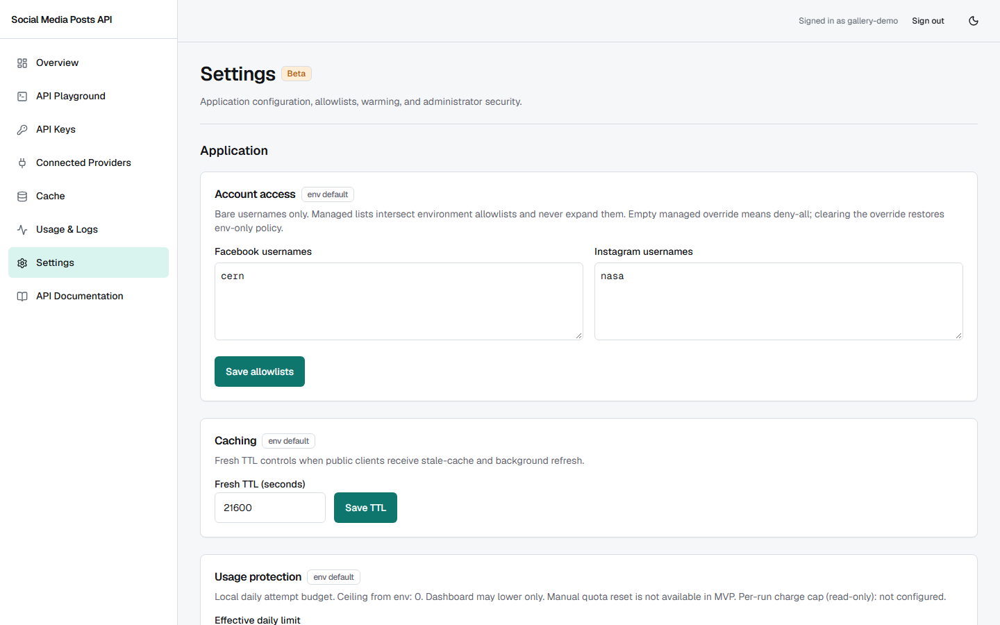

**Settings** covers allowlists, cache fresh TTL, and local usage protection. Demo allowlists use public sample usernames (`cern`, `nasa`). No MFA enrollment secrets are shown.

---

## 8. API Documentation

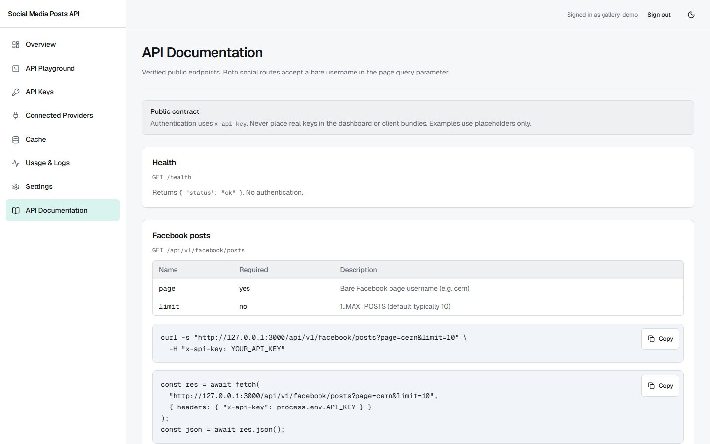

In-app **API Documentation** documents the public contract and copyable examples. Examples use placeholders such as `YOUR_API_KEY` / `process.env.API_KEY` only.

---

## 9. Mobile & Tablet Navigation

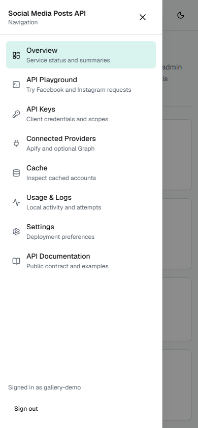

**Mobile (390×844)** — navigation drawer open over Overview, with full route list and signed-in demo user.

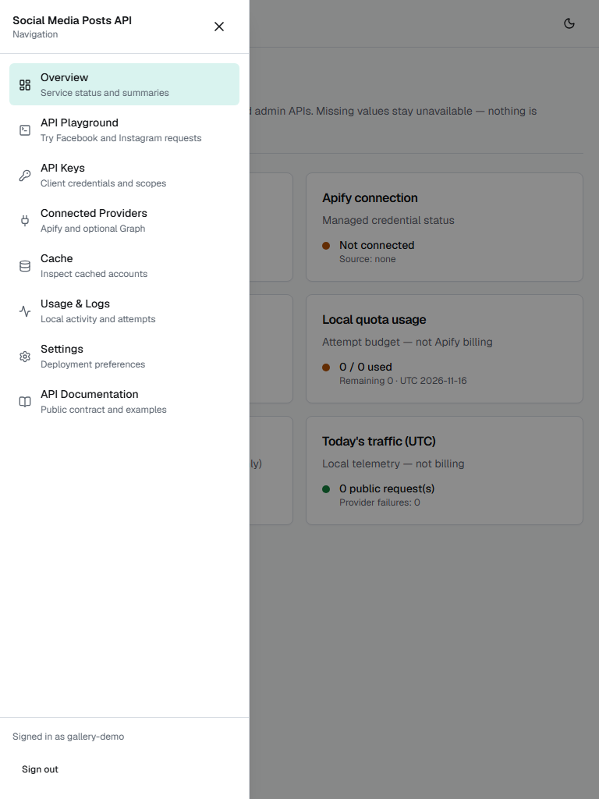

**Tablet (768×1024)** — drawer open with overlay and spacing appropriate for mid-size viewports.

---

## Regenerating captures

Maintainers can regenerate isolated captures with:

```bash
node scripts/capture-dashboard-gallery.mjs
```

Requires Docker and Playwright Chromium. The script never targets owner Compose project `:8080` volumes.
