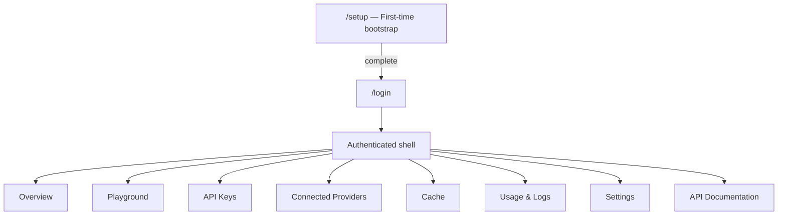

# Dashboard requirements

**Phase:** 7A design; **7B UI foundation implemented** in `apps/dashboard` (local preview only — see `apps/dashboard/README.md`).  
**Stack:** Next.js App Router 16.4.5, React 19, TypeScript strict, Tailwind 4, Lucide, hand-rolled shadcn-style primitives (see ADR-001).

---

## 1. Design principles

- Professional **developer tool**: minimal, credible, readable — not a marketing SaaS dashboard.
- One composition per primary view; clear hierarchy; no fake analytics.
- Light + dark themes via design tokens; accessible contrast; keyboard navigation.
- Responsive: desktop sidebar; tablet/mobile drawer navigation.
- Empty / loading / error / success states for every data view.
- **No mock posts presented as live scrape results.** Demo fixtures must be labeled if used in offline docs only.

---

## 2. Information architecture



Unauthenticated users: only `/setup` (if incomplete), `/login`, and public marketing/docs pages if any. All management routes require admin session.

---

## 3. Screens

### A. Overview

**Purpose:** Instant health of this deployment.

| Widget | Data source (planned) | Notes |
| --- | --- | --- |
| API service status | `GET /health` + admin ping | Up / down |
| Apify connection | Settings store | Connected / missing / invalid |
| Platforms | Static + config | Facebook + Instagram supported |
| Local quota | `apify-quota.json` via admin API | Consumed / limit / UTC date — **not** Apify billing |
| Cache summary | Cache index API | Entry count; oldest/newest fetch |
| Recent activity | Local usage events | Last N admin/API events |
| Errors / warnings | Aggregated | Cooldown pages, enrichment off, single-replica note |

**Acceptance:** Page loads with session; no secrets; quota labeled as local attempt budget.

### B. API Playground

**Inputs**

- Platform: Facebook | Instagram
- Username (`page`) — bare username validation matching server rules
- Limit — default **10**, clamp to `MAX_POSTS`
- Mode: **Cache only** | **Live refresh** (explicit)

**Outputs**

| Mode | Content |
| --- | --- |
| Visual preview | Page name, logo or fallback, posts (text, images, video thumbs, carousel when present), dates, stats, permalinks |
| Raw JSON | Full success/error envelope |
| Request info | Method, path, query, auth type used (admin BFF — not user API key) |
| Metadata | `meta.source`, `provider`, `fetched_at`, `cache_age_seconds`, `stale`, `warning`, HTTP status |

**Live refresh rules**

1. Show local quota remaining before confirm.
2. Require explicit confirm when the action may call Apify (cold miss, stale refresh, or **admin force refresh**).
3. Never auto-retry paid failures.
4. Deduplicate concurrent identical requests (rely on API single-flight).
5. Fresh-cache force refresh: only via new admin endpoint; still reserved against quota.

**Do not** promise `stats.shares` on Instagram (always 0 today) or complete carousels under `basicData`.

**Acceptance:** Cache-only path never increments Apify quota; live path documents cost risk; XSS-safe rendering.

### C. API Keys

- Create (name + optional FB/IG username scopes)
- Copy secret **once** with clear warning
- List metadata; revoke; rotate
- Never redisplay raw secret

**Acceptance:** Revoked key gets `401` on posts API; scoped key gets `403` for out-of-scope usernames.

### D. Connected Providers

- Apify: status, last validated, set/replace/disconnect, validate button
- Optional Graph tokens: **DEFER** rich UI if needed; env remains supported
- Instagram enrichment toggle (default off) with shared-quota warning

### E. Cache management

Table/cards: platform, username, last fetched, age, fresh/stale, post count.

Destructive actions (purge entry / purge all): confirm modal + CSRF-protected POST.

**Acceptance:** Purge does not reset Apify quota unless explicitly separate action (quota reset should be even more guarded or omitted in MVP).

### F. Usage & Logs

Local counters/events:

- API request counts (by route/client if available)
- Cache hits vs live/stale
- Provider attempts / failures
- Rate-limit events
- Quota reservations

**Labeling:** Never call local counters “Apify account spend” or “USD charged.”

### G. Settings

| Setting | Hot reload vs restart |
| --- | --- |
| Apify token | Hot (runtime holder) |
| API keys / scopes / allowlists | Hot |
| `FRESH_TTL`, warm lists, enrichment flag, daily limit | Prefer hot where safe; document if restart |
| `PORT`, `HOST`, `CACHE_DIR`, TLS | Restart / Compose |

Admin password change; session timeout prefs (optional MVP).

### H. API documentation (in-app)

Mirror public contract: endpoints, auth, `page`/`limit`, examples (`cern` / `nasa`), schema, errors, copyable curl/fetch snippets. Link to `docs/API_CONTRACT.md` / README. Neutral examples only.

---

## 4. User journeys

### J1 — First deploy

1. `docker compose up -d --build`
2. Obtain bootstrap token (env or volume file)
3. Open `https://<domain>/setup`
4. Set admin password + confirm token
5. Login → Overview shows Apify disconnected
6. Connect Apify → validate → save
7. Create API key → copy once
8. Playground: cache-only against known username or live with confirm

### J2 — Integrate a website

1. Create scoped API key for site
2. Copy docs snippet with `x-api-key`
3. Site calls posts API; dashboard Usage shows activity

### J3 — Cost-safe browsing

1. Prefer Cache only in Playground
2. Inspect quota widget before Live refresh
3. Decline confirm → no upstream call

---

## 5. Access control matrix

| Capability | Anonymous | Admin session | API key |
| --- | --- | --- | --- |
| View setup (incomplete) | Yes + token | — | No |
| Login | Yes | — | No |
| Overview / settings / keys | No | Yes | No |
| Playground execute | No | Yes | No |
| Public posts GET | No* | No | Yes |

\*Unless operator deliberately opens CORS for browsers — still requires API key.

---

## 6. UI architecture (implementation guidance for 7B)

Suggested tree under `apps/dashboard/`:

```text
app/                 # App Router pages
components/ui/       # primitives (shadcn-style)
components/layout/   # shell, nav
features/            # playground, keys, providers, cache, …
lib/api/             # server-only admin client
lib/auth/            # session helpers (server)
hooks/               # client hooks sparingly
types/               # shared DTO types
```

- Prefer Server Components for read views; Client Components for playground interactions.
- Server Actions / Route Handlers only as BFF to API admin routes — **no scrape logic**.
- No global client store required for MVP; URL + server fetch sufficient.

### Visual system

- Design tokens: background, surface, border, text, accent, danger, success (CSS variables).
- Avoid purple-gradient “AI dashboard” clichés; prefer neutral surfaces + one accent.
- Tables → card lists on narrow viewports.
- Motion: subtle page/panel transitions only (2–3 purposeful motions max).

---

## 7. Responsive & a11y acceptance

- [ ] All primary flows usable at 360px width
- [ ] Focus visible; skip link; labeled inputs
- [ ] Color not sole status signal
- [ ] Dialogs trap focus; Esc closes
- [ ] `prefers-reduced-motion` respected

---

## 8. Out of scope for dashboard MVP

- Multi-admin RBAC
- Billing / Apify wallet UI beyond “validation succeeded”
- Editing raw Actor JSON input (advanced — later)
- Public anonymous playground
- Mobile native apps
