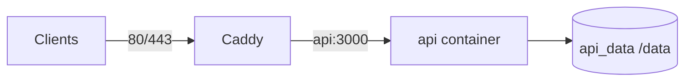
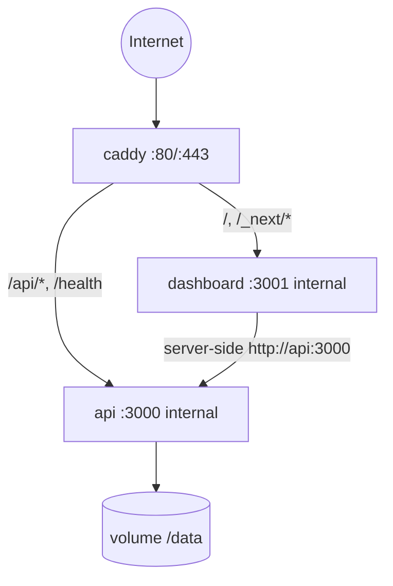

# Deployment design

**Phase:** 7A design only  
**Related:** [ADR-007](./decisions/ADR-007-docker-topology.md)  
**Current evidence:** `Dockerfile`, `docker-compose.yml`, `Caddyfile`, `.dockerignore`, `docs/PRODUCTION_CHECKLIST.md`

---

## 1. Goals

- One command: `docker compose up -d --build`
- One public origin (HTTPS)
- Durable volume for cache, quota, and management data
- API reachable by external backends with `x-api-key`
- Admin UI protected by session; no open admin APIs
- Preserve **single API replica** while quota is filesystem-based

---

## 2. Current deployment (as shipped)



| Service | Image / build | Ports | Role |
| --- | --- | --- | --- |
| `api` | build `.` | expose 3000 only | Posts API |
| `caddy` | `caddy:2` | 80, 443 | TLS + reverse_proxy |

Secrets: Compose `env_file: .env`. Domain: `API_DOMAIN`. Healthcheck: `wget` → `/health`.

**Gaps for product vision:** no dashboard container; Caddy routes only to API; setup is manual `.env` editing.

---

## 3. Target Compose topology



| Service | Responsibility |
| --- | --- |
| `caddy` | Public TLS; path routing; long `response_header_timeout` for live scrapes (today 200s) |
| `api` | Existing Node API + future admin routes; mounts `/data` |
| `dashboard` | Next.js standalone output; no public DB credentials; talks to `api` on Docker network |

**Do not** publish host ports for `api` or `dashboard` in production Compose — only Caddy.

---

## 4. Suggested routing (Caddy)

Conceptual (exact file updated in 7E):

```caddyfile
{$API_DOMAIN} {
  encode gzip

  handle /health {
    reverse_proxy api:3000
  }

  handle /api/* {
    reverse_proxy api:3000 {
      transport http {
        response_header_timeout 200s
      }
    }
  }

  handle {
    reverse_proxy dashboard:3001
  }
}
```

Same-origin cookies work for admin session without cross-site issues.

---

## 5. Images and builds

### API image (evolve carefully)

- Keep multi-stage optional; today single-stage Alpine + `USER node`.
- Continue excluding `.env`, `data`, tests from image (`.dockerignore` already excludes `*.md`, `test`, `.env`, `data`).
- When management code lands, still run as non-root.

### Dashboard image

- Follow Next.js **standalone** output recommendations for Docker.
- Build with secrets **not** in `NEXT_PUBLIC_*`.
- Runtime env: `API_INTERNAL_URL=http://api:3000`, public URL for redirects.

### Dependency policy note

API historically has **zero runtime npm deps**. Dashboard will have many. Prefer **separate package.json** under `apps/dashboard` so API image does not install Next.js. Management features on API may add first carefully justified dependency or use Node built-ins (ADR-006).

---

## 6. Volumes and paths

| Mount | Contents |
| --- | --- |
| `/data/cache` | Post cache, `apify-quota.json`, Instagram profile meta |
| `/data/management` | SQLite / encrypted management files |
| `/data/bootstrap` | Optional one-time setup token file |
| Caddy volumes | TLS certs / config (unchanged pattern) |

File permissions: create dirs as `node` before volume use (existing Dockerfile comment remains relevant).

---

## 7. Secrets injection

| Secret | Injection |
| --- | --- |
| `BOOTSTRAP_SETUP_TOKEN` | Compose secret / env — first run only |
| `DATA_ENCRYPTION_KEY` | Required once management secrets exist |
| `API_KEYS` / `APIFY_TOKEN` | Optional bootstrap for headless; dashboard can supersede |
| Dashboard session signing | Server-only env on API (sessions owned by API) or shared HMAC secret |

Never bake secrets into images. Never commit `.env`.

---

## 8. Networking and exposure

| Endpoint | Public | Auth |
| --- | --- | --- |
| Dashboard UI | Yes | Session after setup |
| `/api/v1/admin/*` | Via same origin | Admin session (+ CSRF) |
| `/api/v1/facebook/posts` etc. | Yes | API key |
| `/health` | Yes | None (no secrets) |
| Apify | Egress only from `api` | Operator token |

Browser must not call Apify. Dashboard server components/actions call `api` over the private Docker network.

---

## 9. Health, restart, shutdown

- Keep API `/health` for Compose healthcheck.
- Add dashboard health (e.g. `/api/health` or Next ready check) in 7E.
- `restart: unless-stopped` retained.
- API already handles SIGTERM (warmer stop + `server.close`). Dashboard should likewise drain.
- Quota warning in logs: single-replica only — Compose `deploy.replicas` must stay 1 (or omit Swarm scaling).

---

## 10. Local development mode

| Mode | Approach |
| --- | --- |
| API only | `npm start` with `.env` (today) |
| API + dashboard | Concurrent `node src/index.js` + `next dev`; Next rewrites `/api` → `localhost:3000` |
| Full Compose | `docker compose up --build` against local domain / `localhost` with Caddy or published ports for dev only |

Dev may publish ports for convenience; production Compose should not.

---

## 11. Upgrades and rollback

1. Pull new images / rebuild.
2. Backup `/data` first.
3. Apply management migrations on API start (forward-only).
4. Roll back = previous image + restored volume snapshot.
5. Do not assume volumes sync across hosts.

---

## 12. Backup / recovery (ops)

See [STORAGE_AND_CONFIG_DESIGN.md](./STORAGE_AND_CONFIG_DESIGN.md) § Backup. Checklist item for 7F user docs.

---

## 13. Resource expectations (order-of-magnitude)

| Component | Notes |
| --- | --- |
| API | Light idle; spikes on live Apify (CPU/network); disk grows with cached pages |
| Dashboard | Modest Node memory for Next standalone |
| Caddy | Negligible |

Exact sizing is operator-specific; live scrape timeout budget already ~150s+ per Actor call.

---

## 14. Acceptance criteria for deployment phase (7E)

- [ ] `docker compose up -d --build` brings up proxy + api + dashboard
- [ ] HTTPS (or documented local HTTP) serves UI and API on one host
- [ ] External posts request with API key works through proxy
- [ ] Unauthenticated `/api/v1/admin/*` denied
- [ ] Volume retains cache + quota across restart
- [ ] No secrets in image layers or compose overrides committed
- [ ] Existing `scripts/docker-smoke.sh` evolved or sibling smoke covers new topology
- [ ] Offline unit/e2e/postman still pass without Apify
