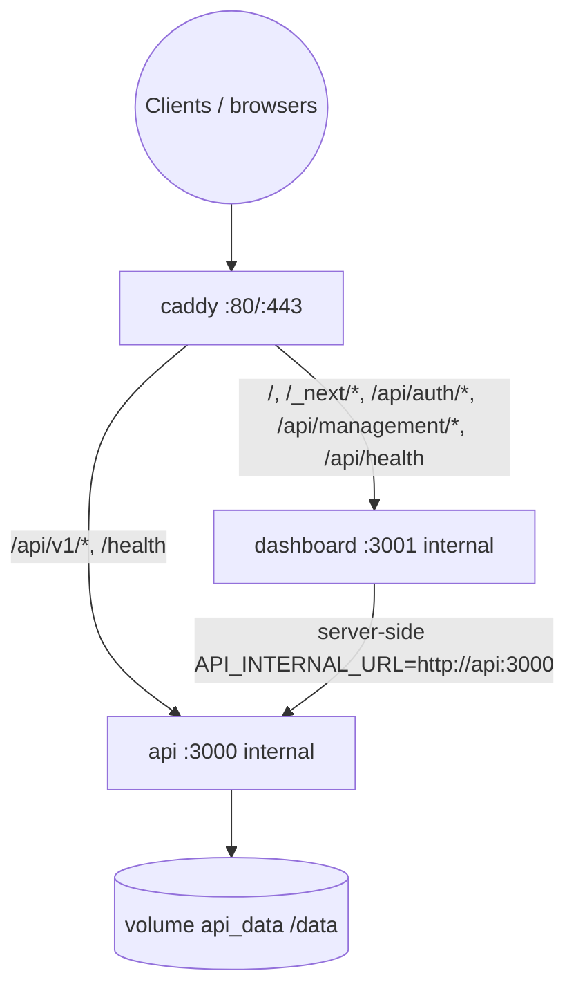

# Deployment design

**Phase:** 7E implemented  
**Related:** [ADR-007](./decisions/ADR-007-docker-topology.md)  
**Operator guides:** [SELF_HOSTING_GUIDE.md](../SELF_HOSTING_GUIDE.md), [BACKUP_RESTORE.md](../BACKUP_RESTORE.md)

---

## 1. Goals

- One command after secrets: `docker compose up -d --build`
- One public origin (HTTPS in production; loopback HTTP for local)
- Durable volume for cache, quota, and management data
- API reachable by external backends with `x-api-key`
- Admin UI protected by session; no open admin APIs
- Preserve **single API replica** while quota is filesystem-based

---

## 2. Compose topology (shipped)

| Service | Build / image | Host ports | Role |
| --- | --- | --- | --- |
| `api` | root `Dockerfile` | none (expose 3000) | Posts API + admin HTTP + SQLite |
| `dashboard` | `apps/dashboard/Dockerfile` | none (expose 3001) | Next.js UI + BFF |
| `caddy` | `caddy:2` | prod 80/443; local `127.0.0.1:8080` | TLS (prod) + path routing |

Network: `smp_net` (bridge). Volumes: `api_data`, `caddy_data`, `caddy_config`.

**Do not** publish host ports for `api` or `dashboard` in production. **Do not** scale `api` replicas.

---

## 3. Caddy routing (critical)

Two API layers share the `/api` prefix. Catch-all `/api/*` → Node is **incorrect**.

| Path | Upstream |
| --- | --- |
| `/health` | `api:3000` |
| `/api/v1/*` | `api:3000` (200s response header timeout for live scrapes) |
| `/api/auth/*` | `dashboard:3001` |
| `/api/management/*` | `dashboard:3001` |
| `/api/health` | `dashboard:3001` |
| everything else (`/`, `/_next/*`, pages) | `dashboard:3001` |

Files: `Caddyfile` (production domain + HSTS), `Caddyfile.local` (HTTP `:80`, no HSTS).

---

## 4. Local vs production

| | Local | Production |
| --- | --- | --- |
| Compose | `-f docker-compose.yml -f docker-compose.local.yml` | `docker-compose.yml` |
| Browser origin | `http://127.0.0.1:8080` | `https://$API_DOMAIN` |
| `ADMIN_COOKIE_SECURE` | `0` | `1` |
| Ports | loopback 8080 only | 80 + 443 |
| TLS | none | Caddy automatic HTTPS |

`ADMIN_ALLOWED_ORIGINS` must match the **browser** origin, never `http://api:3000` or `http://dashboard:3001`.

---

## 5. Secrets & bootstrap

Required before first useful start:

- `BOOTSTRAP_SETUP_TOKEN`
- `ADMIN_INTERNAL_SECRET` (identical on api env and dashboard env)
- `DATA_ENCRYPTION_KEY`
- `ADMIN_ALLOWED_ORIGINS`

Optional: `APIFY_TOKEN`, `API_KEYS`, SMTP. Operators can connect Apify and create keys in the UI after setup.

Generate missing values without overwrite: `npm run secrets:generate`.

Never bake secrets into image build args, `NEXT_PUBLIC_*`, or Git.

---

## 6. Persistence

| Path in container | Contents |
| --- | --- |
| `/data/cache` | Post caches, Instagram profile meta, `apify-quota.json` |
| `/data/management` | SQLite (schema migrations on startup), sessions, keys, encrypted credentials |

API entrypoint (`scripts/docker-entrypoint-api.sh`) chowns `/data` then drops to `node` via `su-exec`.

---

## 7. Healthchecks

- API: `GET http://127.0.0.1:3000/health` (Node fetch; no Apify)
- Dashboard: `GET http://127.0.0.1:3001/api/health`
- Caddy: `depends_on` healthy api + dashboard

---

## 8. Verification

- `npm run compose:config`
- `npm run compose:smoke` — isolated project, synthetic secrets, cleanup with `down -v` **only** for that project
- Unit / E2E / Postman offline remain API contract gates

Live public HTTPS and paid Apify acceptance remain operator-side (Phase 7F).

---

## 9. Acceptance criteria (7E)

- [x] `docker compose up -d --build` starts three services after `.env` secrets
- [x] Same-origin dashboard + BFF + public posts API via Caddy
- [x] Dashboard production image uses standalone output, non-root
- [x] Volume data survives container restart/rebuild
- [x] Documented backup/restore and self-hosting guide
- [ ] Real domain HTTPS certificate issuance — NOT claimed without operator DNS
