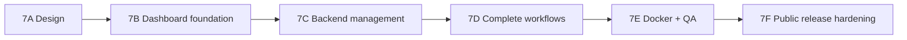

# Implementation roadmap

**Phase:** 7A complete when these docs land and offline tests still pass.  
**Rule:** Each later phase must keep public posts contract stable and run `npm test` (plus relevant suites).

---

## Phase overview

Dependencies are hard unless noted. No calendar estimates.

---

## 7A — Product architecture & security design *(this phase)*

**Deliverables:** Docs under `docs/product/` + ADRs.  
**Must not:** Scaffold Next.js, change runtime, add deps, clear caches.  
**Acceptance:** Docs accurate vs repo; `npm test`, `npm run e2e`, `npm run postman:offline` pass; docs-only commit.

---

## 7B — Dashboard foundation

**Depends on:** 7A.

**Work**

- Create `apps/dashboard` Next.js App Router + TypeScript skeleton (no scrape logic).
- Pin stable versions of Tailwind / shadcn / Lucide / RHF / Zod after compatibility check.
- App shell: nav, light/dark tokens, responsive layout, empty placeholders for screens.
- Server-only API client stub pointing at configurable `API_INTERNAL_URL`.
- ESLint/tsconfig; ensure no secrets in `NEXT_PUBLIC_*`.
- Root scripts optional (`workspace` or documented `npm run` from subdirectory).

**Acceptance**

- [ ] `next build` succeeds for dashboard
- [ ] Placeholder routes for Overview, Playground, Keys, Providers, Cache, Usage, Settings, Docs
- [ ] Existing API package tests unchanged / still green
- [ ] No runtime behavior change to posts API

**Risks:** Monorepo tooling sprawl — keep minimal.

---

## 7C — Backend management capabilities

**Depends on:** 7A; can parallelize lightly with 7B UI shell but needs API before real UI wiring.

**Work**

- Management storage (SQLite or interim encrypted files) + migrations.
- Bootstrap setup + admin password hashing + sessions + CSRF + login rate limits.
- Admin HTTP routes under `/api/v1/admin/*` (session auth).
- Encrypted Apify token save/validate/disconnect + runtime config holder.
- API key CRUD (hash at rest, one-time plaintext), scopes hot-reload.
- Read APIs: quota status, cache listing, health detail.
- Admin **force refresh** endpoint wrapping existing `refresh()` + quota (for playground).
- Import/overlay path for existing `API_KEYS` / `APIFY_TOKEN` env.
- Security tests for threats 1–5, 13, 17, 19 from SECURITY_ARCHITECTURE.

**Acceptance**

- [ ] Setup takeover tests pass
- [ ] Admin session cannot be used as `x-api-key`; API key cannot hit admin routes
- [ ] Token never returned after save; never logged
- [ ] Public posts contract tests still pass
- [ ] Cache/quota files not wiped by migrations

**Risks:** First runtime dependency decision (ADR-006 OPEN); hot-reload correctness.

---

## 7D — Complete user workflows

**Depends on:** 7B + 7C.

**Work**

- Wire all dashboard screens to admin APIs.
- Playground visual + JSON + metadata; cache-only vs live confirm UX.
- XSS-safe rendering; CSP groundwork.
- Settings: allowlists, warm lists, TTL, enrichment toggle with warnings.
- In-app API documentation with neutral examples.
- Usage & logs views (local counters only).
- Cache purge with confirmations.

**Acceptance**

- [ ] Journeys J1–J3 from DASHBOARD_REQUIREMENTS succeed against fake upstream / cache-only
- [ ] Live refresh blocked or confirmed when quota exhausted
- [ ] Mobile nav usable for primary flows
- [ ] No fabricated “real” scrape data in UI

**Risks:** Accidental Apify calls in CI — keep fakes; gate live behind explicit scripts.

---

## 7E — Docker integration and QA

**Depends on:** 7D (MVP feature-complete).

**Work**

- Compose: `caddy` + `api` + `dashboard`; same-origin routes.
- Dashboard Dockerfile (standalone).
- Healthchecks; volume paths for management.
- Evolve docker smoke / add dashboard smoke (no real Apify).
- CI: build dashboard; keep matrix Node tests for API.
- Backup/restore doc dry-run.

**Acceptance**

- [ ] Criteria in DEPLOYMENT_DESIGN §14
- [ ] `postman:offline` + unit + e2e green
- [ ] Single-replica documented and enforced in compose comments

**Risks:** Cookie Secure flags on HTTP local vs HTTPS prod — document both.

---

## 7F — Public release hardening

**Depends on:** 7E.

**Work**

- README rewrite for self-hosted platform UX (compose-first).
- SECURITY.md reporting; CONTRIBUTING; **LICENSE choice (owner)**.
- Dependency update policy; secret scanning in CI.
- Privacy regression includes dashboard artifacts.
- Separate plan for historical Git exposure (no silent rewrite).
- Optional: Graph token UI, multi-admin — only if prioritized.

**Acceptance**

- [ ] Fresh clone → compose → setup → Apify connect → key create → playground documented
- [ ] LICENSE present (owner-selected)
- [ ] No private customer data in tracked files
- [ ] Threat mitigations for release checklist signed off

---

## Cross-cutting constraints (all phases)

1. Do not change public response field names/types without coordinated contract updates.
2. Never overwrite good cache with empty/failed upstream.
3. Never log or return secrets.
4. No paid Apify in default CI / `postman:offline`.
5. Neutral public examples only (`cern`, `nasa`).
6. Single API replica until shared quota exists.

---

## Open decisions (product owner)

| ID | Topic | Recommendation | Needs approval |
| --- | --- | --- | --- |
| O1 | OSS license | Do not auto-pick | **Yes** |
| O2 | Management storage driver | SQLite (`node:sqlite` or `better-sqlite3`) vs encrypted JSON interim | **Yes** if adding npm dep or bumping engines |
| O3 | Password KDF library | Argon2id via audited dep vs scrypt built-in | Prefer Argon2id with dep justification |
| O4 | Historical Git remediation | Separate approved rewrite or leave + document | **Yes** before any history rewrite |
| O5 | Env API key migration UX | Dual-read overlay vs forced import at first admin login | Confirm product preference |
| O6 | Force-refresh naming / API shape | Admin-only POST | Confirm before 7C freeze |

---

## Suggested sequencing note for implementers

Start 7B skeleton early for UI iteration, but **do not** call Apify from Next.js. Block playground “live” on 7C admin force-refresh + quota APIs. Treat 7E as the first time Compose is the primary happy path.
