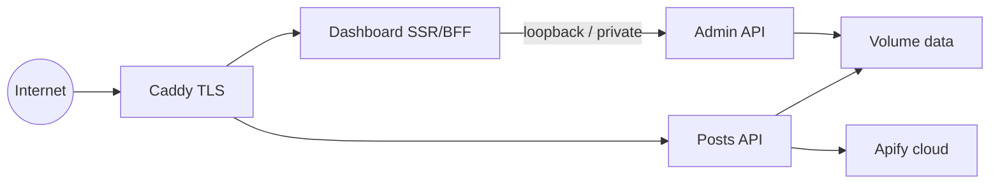

# Security architecture

**Phase:** 7A design; **7C.1 + 7C.1B + 7C.2 + 7D.1 + 7D.2 implemented** (admin auth/MFA, encrypted Apify credentials, managed API keys, confirmed playground refresh, settings/allowlists, per-account cache delete, local usage telemetry). Purge-all / quota reset / Compose HTTPS remain later.  
**Companion ADRs:** [ADR-003](./decisions/ADR-003-admin-auth.md), [ADR-004](./decisions/ADR-004-apify-token.md), [ADR-005](./decisions/ADR-005-api-keys.md)

---

## 1. Security goals

1. A freshly deployed instance on a public IP must **not** be claimable by arbitrary visitors.
2. Administrator sessions must be distinct from public **API keys**.
3. Apify tokens and API key secrets must never appear in browser bundles, public JSON, logs, or Git.
4. Paid Apify work must remain under existing quota / USD-cap controls.
5. Scraped content rendered in the dashboard must not become an XSS vector.
6. The open-source tree must stay free of customer-specific private data.

---

## 2. Trust boundaries

| Zone | Trusted for |
| --- | --- |
| Browser | UI only; session cookie (httpOnly); no long-lived secrets |
| Dashboard server | Session validation via API; may hold CSRF tokens |
| API process | All secrets, encryption keys, provider calls |
| Volume | Encrypted secrets + hashes; posts cache (semi-sensitive) |
| Apify | Operator’s third-party account |

---

## 3. First-time setup (bootstrap)

### 3.1 Strategies analyzed

| Strategy | Pros | Cons | Verdict |
| --- | --- | --- | --- |
| **A. Operator-supplied one-time bootstrap secret** (`BOOTSTRAP_SETUP_TOKEN` in env / secret file mounted at start) | Works on public IP; no race with “first visitor”; no default password | Operator must generate/inject token before exposing UI | **Primary recommendation** |
| **B. Generate token to volume file `0600`** (e.g. `/data/bootstrap/setup-token`) | Good UX for SSH operators (`docker compose exec` / volume read) | If volume permissions wrong, leak; must not print token in shared logs by default | **Secondary delivery channel** |
| **C. Localhost-only setup binding** | Strong network gate | Breaks remote Docker/VPS setups unless SSH tunnel; easy to misconfigure | **Optional hardening**, not sole control |
| **D. Docker-provided default admin password** | Convenient | Default/shared passwords get scanned; violates “no default admin password” | **Rejected** |
| **E. Public open registration until first user** | Simple | Classic setup-takeover on public internet | **Rejected** |

### 3.2 Selected model (7C.1)

**Primary (implemented):** Operator generates a high-entropy setup token (≥128 bits) and injects it as `BOOTSTRAP_SETUP_TOKEN` **before** exposing the dashboard. If the token is unset and no admin exists, setup **fails closed** with actionable guidance (no auto-generated public token in MVP).

**Password KDF (implemented):** Node.js `crypto.scrypt` (memory-hard). Parameters stored beside the hash for future Argon2id migration. Argon2id was deferred to avoid native addons in the zero-npm Docker image.

**Rules (enforced in code + tests):**

- No default admin password / no public registration.
- Setup completes atomically in SQLite (`BEGIN IMMEDIATE`).
- Concurrent setup: only one admin (`id=1`); losers get `409 SETUP_COMPLETED`.
- Completed setup stays completed across restarts even if `BOOTSTRAP_SETUP_TOKEN` remains set.
- Recovery: `npm run admin:recover -- --password …` (host filesystem only).

### 3.3 Setup takeover threat model

| Scenario | Mitigation |
| --- | --- |
| Attacker hits `/setup` before operator | Without valid bootstrap token → deny |
| Token leaked in CI logs | Do not echo token unless opt-in; redact in logging middleware |
| Race of two legitimate setups | Atomic consume |
| Operator exposes port 80 before setting token | Document mandatory order; optional fail-boot if `REQUIRE_BOOTSTRAP_TOKEN=1` and public bind |

---

## 4. Administrator authentication

### 4.1 Separation of concerns

| Mechanism | Audience | Transport | Purpose |
| --- | --- | --- | --- |
| **Admin login** | Human operator | Session cookie (`Secure`, `HttpOnly`, `SameSite=Lax` or `Strict`) | Dashboard / management |
| **API keys** | Machines / site backends | `x-api-key` / Bearer | Public posts endpoints only |

Admin cookies **must not** authorize `/api/v1/facebook/posts` or Instagram posts.  
API keys **must not** authorize `/api/v1/admin/*`.

### 4.2 Password storage

- Modern password KDF: **Argon2id** preferred (or scrypt if Argon2 unavailable without deps).  
  **OPEN:** Adding a crypto dependency vs Node built-ins — see ADR-003.
- Parameters tuned for interactive login; store salt + parameters with hash.
- Constant-time compare of derived values where applicable.

### 4.3 Sessions

- Server-side session store (SQLite/file): random session id (≥128 bits), hashed at rest optional.
- Absolute and idle timeouts (recommend: idle 12h, absolute 7d — tunable).
- Rotate session id on login and password change.
- Logout deletes server session.
- Credential change / password reset invalidates all sessions for that admin.
- Cookie: `Secure` in HTTPS deployments; path scoped; no localStorage tokens.

### 4.4 CSRF

- SameSite cookies reduce risk; still use **synchronizer token** or **double-submit** for state-changing admin POSTs from the browser.
- Server Actions / form posts must validate CSRF or use Next.js built-in patterns carefully with custom backends.

### 4.5 Login abuse controls

- Per-IP and per-account rate limits on `/login` and `/setup`.
- Generic error messages (“Invalid credentials”) — no user enumeration beyond setup-complete boolean if unavoidable.
- Optional temporary lockout after N failures.
- Auth event audit log (success/failure) without passwords/tokens.

### 4.6 Password reset / recovery (MVP)

- **No anonymous email password reset** (enumeration / takeover risk).
- Optional SMTP is used only for **authenticated email verification OTPs**; absent SMTP never claims verification success.
- Recovery = host access: `scripts/admin-recover.js` (interactive password preferred) resets hash, clears MFA/recovery codes, revokes sessions.

### 4.7 Reverse proxy

- Trust `X-Forwarded-*` only from known proxy (Caddy on Docker network).
- Do not accept client-supplied `X-Forwarded-User` as authentication.
- Generate absolute URLs using configured public origin.

---

## 5. Apify token lifecycle

1. Admin enters token in Settings (password-style input).
2. Server validates via Apify HTTP API (e.g. user/identity endpoint) — **access check only**, not balance guarantee.
3. On success: encrypt and store; update runtime config holder; never return full token again (show last-4 / status only).
4. Replace / disconnect: overwrite or delete ciphertext; clear runtime token; providers stop supporting Apify until set again.
5. Env `APIFY_TOKEN` remains valid **bootstrap/fallback** for headless deploys; dashboard-managed token takes precedence once set (document precedence clearly).

**Never:** `NEXT_PUBLIC_*`, localStorage, Postman committed envs, Git, response bodies, or info logs.

Error taxonomy for UI (generic messages to client; detail only in server debug if needed):

| Condition | UI class |
| --- | --- |
| HTTP 401 from Apify | Invalid token |
| HTTP 403 | Permission failure |
| Network / timeout | Network failure |
| HTTP 402 / credit signals | Account restriction / credits (heuristic) |
| Local `reserve()` fail | Local quota exhausted |
| Unexpected JSON | Unexpected provider response |

---

## 6. API key lifecycle

| Action | Behavior |
| --- | --- |
| Create | Generate cryptographically secure secret; store **hash** + metadata; return plaintext **once** |
| List | id, name, created_at, last_used_at, scopes — **no** secret |
| Rotate | Issue new secret; invalidate old hash (or dual-hash grace — optional) |
| Revoke | Delete/disable hash immediately |
| Scopes | Facebook usernames + `instagram:<user>` as today |

Migration from `API_KEYS` env: on first management boot, import env keys as hashes (plaintext discarded after import) **or** keep env keys as read-only overlay until admin migrates. Fail closed on duplicate names.

Verification remains timing-safe hash compare (as today’s SHA-256 approach, or upgrade to keyed HMAC/random pepper — document if pepper added).

---

## 7. Threat model (selected)

| # | Threat | Severity | Current defenses | Missing | Mitigation | Test | Phase |
| --- | --- | --- | --- | --- | --- | --- | --- |
| 1 | Unauthorized admin claiming | Critical | N/A (no admin UI) | Setup model | Bootstrap token; atomic complete | Concurrent setup e2e | 7C |
| 2 | Admin account compromise | High | N/A | Sessions, rate limit | Strong password, session TTL, audit | Brute-force lock test | 7C–7D |
| 3 | Apify token theft | Critical | Env not in Git; not logged by design | Encrypted store, UI masking | Encrypt at rest; no echo | Secret scan + response assert | 7C |
| 4 | API key theft | High | Header-only auth; timing-safe | Hash at rest; one-time show | Hash storage; revoke UI | Key never in list API | 7C |
| 5 | CSRF on admin | High | N/A | CSRF tokens / SameSite | Mandatory for state change | CSRF negative test | 7C |
| 6 | XSS via post text/media URLs | High | API JSON only today | Dashboard rendering | Escape text; sandbox links; CSP | XSS fixture in UI tests | 7D |
| 7 | SSRF via config URLs | Medium | Page parsers reject arbitrary hosts for posts | Logo/map URL validation exists for IG logos | Reuse HTTPS allow rules; no user-controlled fetch hosts | Logo URL reject tests | 7C |
| 8 | Brute-force login | High | API rate limit exists for keys | Admin login limits | Dedicated login limiter | 429 after N | 7C |
| 9 | Session hijacking | High | N/A | Secure cookies, HTTPS | Secure+HttpOnly; rotate on login | Cookie flag checks | 7C/7E |
| 10 | Cache poisoning | Medium | Key isolation; refuse mismatched `value.key` | Admin write paths | No public cache write; authz on purge | Cross-key tests exist | reuse |
| 11 | Quota exhaustion (DoS cost) | Medium | Daily limit + USD cap | UI warnings | Confirm live refresh; show remaining | Quota e2e | 7D |
| 12 | Unexpected paid Apify runs | High | Cache-first; enrichment off; limit | Admin force-refresh abuse | Explicit confirm; no auto-retry | Playground warns | 7D |
| 13 | Privilege escalation | High | Scopes fail closed | Admin vs API key split | Separate middleware | Cross-auth negative tests | 7C |
| 14 | Docker log secret leak | Medium | Avoid logging keys today | Bootstrap print opt-in | Redaction middleware | Log scan in CI | 7E |
| 15 | Backup exposure | Medium | Operator-owned volumes | Backup docs | Encrypt secrets; warn on raw volume copy | Doc checklist | 7F |
| 16 | Env leakage | Medium | `.gitignore` `.env` | Dashboard env hygiene | No `NEXT_PUBLIC` secrets | Privacy test extend | 7B |
| 17 | Public admin API | Critical | No admin routes yet | Authz on all admin routes | Session required; no CORS * for admin | Unauth 401 suite | 7C |
| 18 | Malicious media | Medium | Clients fetch CDN URLs | UI `img`/`video` | `referrerpolicy`, HTTPS-only display | Manual + CSP | 7D |
| 19 | Concurrent first setup | High | N/A | Atomic bootstrap | Transaction/file lock | Parallel POST setup | 7C |
| 20 | Secrets in Git | High | Privacy tests; `.gitignore` | History may still contain old data | No rewrite in 7A; separate remediation | `public-privacy` tests | ongoing |

No SOC2/ISO claims. Self-hosted operator remains responsible for host hardening.

---

## 8. Content security for playground

- Render post **text** as text nodes (no `dangerouslySetInnerHTML`).
- Media: only `http:`/`https:` URLs; prefer HTTPS; block `javascript:` / data HTML.
- External permalinks: `rel="noopener noreferrer"`.
- CSP headers from Caddy or Next for dashboard (finalize in 7E).

---

## 9. Security test plan (future)

- Bootstrap: invalid token, reuse after complete, concurrent complete.
- Admin: CSRF fail, session expiry, logout, password change kills sessions.
- API keys: create once-visible, list without secret, revoke blocks posts.
- Apify: token never in GET settings body; validation error classes.
- Posts: unauthenticated admin playground cannot call Apify.
- Regression: existing `npm test` / e2e / postman:offline remain green.
- Privacy: extend tracked-file secret scan to new dashboard artifacts.

---

## 10. Historical Git exposure

Prior privacy cleanup removed customer identifiers from **current** tree. Historical commits may still contain sensitive strings. **Do not rewrite history in product phases without an explicit owner-approved plan.** Track as separate remediation; do not claim 7A erased historic objects.
