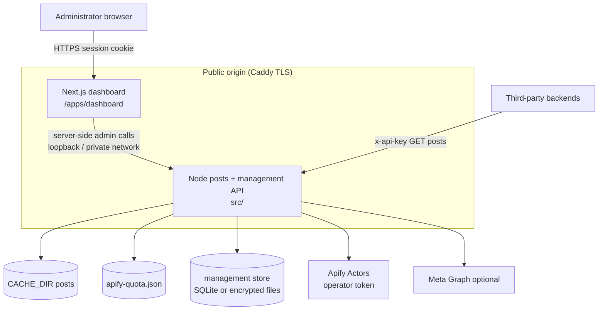
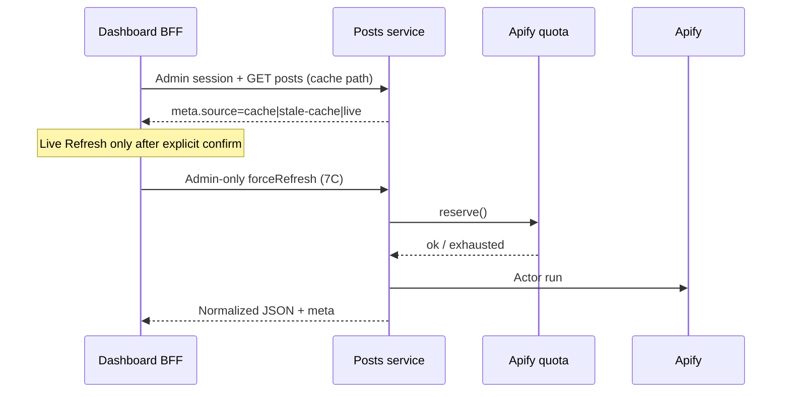

# Self-hosted architecture

**Phase:** 7A design only  
**Product:** Social Media Posts API — Self-Hosted Developer Platform  
**Scope:** Evidence-based target architecture. No runtime changes in this phase.

---

## 1. Product vision (summary)

Operators clone or pull the open-source repository, start **Docker Compose**, open a **web dashboard**, complete **one-time admin setup**, connect **their own Apify token**, manage **API keys** and allowlists, preview posts (cache-first / explicit live), and integrate via the existing public REST contract.

This is **not** a hosted SaaS: one deployment → one administrator → that administrator’s Apify account.

---

## 2. Current architecture (verified)

### 2.1 Entrypoint and process model

| Item | Evidence |
| --- | --- |
| Entrypoint | `src/index.js` — `loadConfig()` → `createService()` → `createApp()` → `listen` |
| HTTP | Node `http.createServer` in `src/server.js` (no Express/Fastify) |
| Runtime deps | **None** (`package.json`); Node `>=20.6`; Docker image `node:22-alpine` |
| Config | Env vars via `loadConfig(process.env)` in `src/config.js` (immutable after startup) |
| Shutdown | SIGINT/SIGTERM stops warmer then closes server |

### 2.2 Public HTTP surface

| Route | Auth | Notes |
| --- | --- | --- |
| `GET /health` | None | `{ status: "ok" }` |
| `GET /api/v1/facebook/posts` | `x-api-key` or `Authorization: Bearer` | `page` = bare Facebook username; `limit` optional |
| `GET /api/v1/instagram/posts` | Same | `page` = bare Instagram username |
| Other methods / routes | — | `405` / `404` with stable error envelope |

Public success contract (stable): `{ success, data: { page, posts[] }, meta }`.  
Public error contract: `{ success: false, error: { code, message } }`.

Username-only input is enforced by `parseFacebookUsername` / `parseInstagramUsername`. Full URLs return `400 INVALID_PAGE_URL`. Canonical internal URLs and cache keys:

- Facebook `cern` → key `cern`, URL `https://www.facebook.com/cern`
- Instagram `nasa` → key `instagram:nasa`, URL `https://www.instagram.com/nasa/`

### 2.3 Authentication and authorization (API keys)

- `API_KEYS=name:secret,...` parsed at startup (`parseApiKeys`).
- Verification: SHA-256 of supplied key vs in-memory hashes with `timingSafeEqual` (`src/server.js`).
- Optional `API_KEY_PAGE_SCOPES` JSON → `Map<clientName, Set<cacheKey>>`.
- Global allowlists: `ALLOWED_PAGES` (Facebook keys), `INSTAGRAM_ALLOWED_PROFILES` (`instagram:*` keys).
- In-memory rate limit per client name (`RATE_LIMIT_PER_MIN`).
- CORS optional via `ALLOWED_ORIGINS` (prefer empty for server-to-server).

**Limitation:** Keys and scopes are **startup-only**. Creating/revoking a key requires env change + process restart. Plaintext secrets live in `.env` / Compose `env_file`.

### 2.4 Providers and secrets

| Provider | Module | Token source |
| --- | --- | --- |
| Meta Graph (optional) | `src/providers/graph.js` | `GRAPH_PAGE_TOKENS` JSON |
| Facebook Apify | `src/providers/apify.js` | `APIFY_TOKEN` |
| Instagram posts Apify | `src/providers/instagramApify.js` | Same token |
| Instagram profile enrichment | `src/providers/instagramProfileApify.js` | Same token; **off by default** |

Provider order: `PROVIDERS` (default `graph,apify`). Instagram Apify is attached whenever `apify` is listed. Shared daily attempt budget: `src/apifyQuota.js` → `CACHE_DIR/apify-quota.json` (single-process only).

### 2.5 Cache, refresh, warmer

- Disk+memory cache: `src/cache.js` (SHA-1 filename per key; atomic tmp+rename).
- Fresh TTL: `FRESH_TTL_SECONDS` (default 6h). Fresh → `meta.source=cache` (no upstream).
- Stale → immediate `stale-cache` + background `refresh()` unless cooldown.
- Cold miss → synchronous live refresh or `502 UPSTREAM_UNAVAILABLE`.
- **No public force-refresh** when cache is still fresh (`getPosts` always returns fresh cache).
- Warmer: `src/cacheWarmer.js` via `WARM_PAGES` / `INSTAGRAM_WARM_PROFILES` (disabled when empty).

### 2.6 Docker today

- `Dockerfile`: copies `package.json` + `src/`, runs as `node`, `CACHE_DIR=/data/cache`.
- `docker-compose.yml`: `api` (expose 3000, volume `api_data`) + `caddy` (80/443) reverse_proxy to `api:3000`.
- `Caddyfile`: single host `${API_DOMAIN}` → API only.
- Documented constraint: **one API replica** while quota is filesystem-based.

### 2.7 Component classification

| Area | Class | Notes |
| --- | --- | --- |
| A. HTTP posts API | **REUSE AS-IS** | Stable contract; keep routes/schema |
| B. API key auth (header) | **EXTEND** | Keep for integrations; add hashed store + runtime CRUD |
| C. Page/profile scopes | **EXTEND** | Same keys; UI-managed allowlists |
| D. Env configuration | **EXTEND** | Retain env bootstrap; add runtime settings for selected fields |
| E. Secrets (Apify/Graph) | **REFACTOR** | Move Apify token to encrypted runtime store + hot apply |
| F. Apify adapters | **REUSE AS-IS** | Swap token source via config holder |
| G. Cache | **REUSE AS-IS** | Keep file cache; admin inspect/delete only |
| H. Quota | **REUSE AS-IS** | Keep `apify-quota.json`; expose read-only status to UI |
| I. Warming | **EXTEND** | UI-configured lists; still shared refresh path |
| J. Logging | **EXTEND** | Structured admin audit events; never log secrets |
| K. Errors | **REUSE AS-IS** | Public envelope unchanged |
| L. Docker | **EXTEND** | Add dashboard service; same-origin routing |
| M. Postman | **REUSE AS-IS** | Integration testing remains complementary |
| N. CI | **EXTEND** | Add dashboard lint/build later (7E) |
| O. Docs | **EXTEND** | Product docs + eventual user guide |
| Admin auth / dashboard | **NEW** | Next.js + management APIs |
| Force live refresh | **NEW** | Admin-only; see playground design |
| Usage analytics DB | **NEW** | Local counters (not Apify billing) |
| Multi-replica quota | **DEFER** | Explicit single-replica MVP |

---

## 3. Target architecture

### 3.1 High-level diagram



### 3.2 Process responsibilities

| Process | Owns | Must not own |
| --- | --- | --- |
| **API (`src/`)** | Scraping, cache, quota, providers, public posts routes, **admin management API**, secret encryption, API-key verification | Browser UI, HTML rendering |
| **Dashboard (`apps/dashboard`)** | Admin UX, forms, playground visualization, docs UI, Server Actions as BFF to admin API | Duplicate scrape/normalize logic, Apify calls from the browser |
| **Caddy** | TLS, single origin routing, timeouts | Business logic |

### 3.3 Same-origin routing (target)

Suggested public paths (exact paths finalized in 7E):

| Path | Upstream |
| --- | --- |
| `/health` | API |
| `/api/v1/facebook/*`, `/api/v1/instagram/*` | API (public posts) |
| `/api/v1/admin/*` | API (admin session / bootstrap only) |
| `/` and other UI routes | Dashboard |

Browser never receives `APIFY_TOKEN` or raw API key secrets (except **once** at key creation).

### 3.4 Runtime configuration model

Today config is a plain object frozen at boot. Target:

1. **Bootstrap env** still loads defaults (`HOST`, `PORT`, `CACHE_DIR`, encryption key, optional initial `APIFY_TOKEN`).
2. **Mutable runtime slice** (Apify token, API keys, allowlists, selected settings) loaded from management store after boot.
3. **Config holder** injected into providers/auth: `getApifyToken()`, `listApiKeyHashes()`, etc.
4. Token/key updates apply **without full process restart** where safe.
5. Settings that alter process topology (listen port, `CACHE_DIR` path) remain **restart-required** and documented in UI.

See [ADR-004](./decisions/ADR-004-apify-token.md), [STORAGE_AND_CONFIG_DESIGN.md](./STORAGE_AND_CONFIG_DESIGN.md).

### 3.5 Dashboard package location

**Recommended:** `apps/dashboard/` (Next.js App Router, TypeScript).

Rationale: keeps `src/` as the zero/low-dep posts engine; dashboard can take UI dependencies without forcing them into the API image layers unnecessarily (multi-stage builds). Optional root `package.json` workspaces later; not required to start 7B.

---

## 4. Integration flows

### 4.1 First boot → admin claim

```mermaid
sequenceDiagram
  participant Op as Operator
  participant API as API process
  participant Store as Management store
  participant UI as Dashboard

  Op->>API: Start with BOOTSTRAP_SETUP_TOKEN or generate-on-volume
  API->>Store: Persist setup token hash; setup_incomplete
  Op->>UI: Open /setup
  UI->>API: POST bootstrap (token + admin password)
  API->>Store: Create admin; invalidate setup token (atomic)
  Op->>UI: Login → session cookie
```

### 4.2 Playground request (cache vs live)



**Gap today:** There is no HTTP way to force refresh a **fresh** cache entry. Playground “Live Refresh” requires a new **admin-only** internal method (e.g. `service.refresh` exposed under `/api/v1/admin/...`) that still uses single-flight + quota. Must not bypass `APIFY_DAILY_RUN_LIMIT` / USD cap.

### 4.3 Third-party integration (unchanged)

External backends continue to call public posts endpoints with `x-api-key`. Dashboard API keys UI provisions those secrets. Admin session cookies are **never** valid as API keys.

---

## 5. Technology decisions (summary)

| Decision | Choice | Detail |
| --- | --- | --- |
| Dashboard | Next.js App Router + React + TS | [ADR-001](./decisions/ADR-001-nextjs.md) |
| Posts engine | Existing Node ESM API | [ADR-002](./decisions/ADR-002-backend-preservation.md) |
| Admin auth | Password + httpOnly session cookie | [ADR-003](./decisions/ADR-003-admin-auth.md) |
| Apify token | Encrypted at rest + runtime apply | [ADR-004](./decisions/ADR-004-apify-token.md) |
| API keys | Hash at rest; show plaintext once | [ADR-005](./decisions/ADR-005-api-keys.md) |
| Management DB | SQLite preferred; file fallback | [ADR-006](./decisions/ADR-006-management-storage.md) |
| Deploy | Compose: caddy + api + dashboard | [ADR-007](./decisions/ADR-007-docker-topology.md) |
| Usage vs quota | Separate local counters; keep quota file | [ADR-008](./decisions/ADR-008-usage-and-quota.md) |

UI stack candidates (install only in 7B after version pin review): Tailwind CSS, shadcn/ui, Lucide, React Hook Form, Zod. **Do not install in 7A.**

---

## 6. Alternatives considered

| Alternative | Why not for MVP |
| --- | --- |
| Rewrite scraping inside Next.js Route Handlers | Duplicates providers/quota/cache; breaks Postman/CI parity |
| PostgreSQL / Redis | Unnecessary for single-instance self-host |
| Multi-tenant orgs | Out of product scope |
| localStorage JWT for admin | XSS token theft; prefer httpOnly cookies |
| Auto-write `.env` and hope Node reloads | Process does not reload env; unsafe and fragile |
| Public registration | Attack surface for admin takeover |

---

## 7. Compatibility commitments

- Public posts routes, query params (`page`, `limit`), auth header, and JSON schemas remain stable.
- Cache keys and quota file format remain readable; no mass invalidation for dashboard work.
- Postman offline/live runners remain valid integration tests for the public API.
- Existing `.env` deployments continue to boot; management features migrate/overlay carefully (see storage design).

---

## 8. Open items requiring owner approval

See [IMPLEMENTATION_ROADMAP.md](./IMPLEMENTATION_ROADMAP.md) § Open decisions and ADRs marked **OPEN**.
