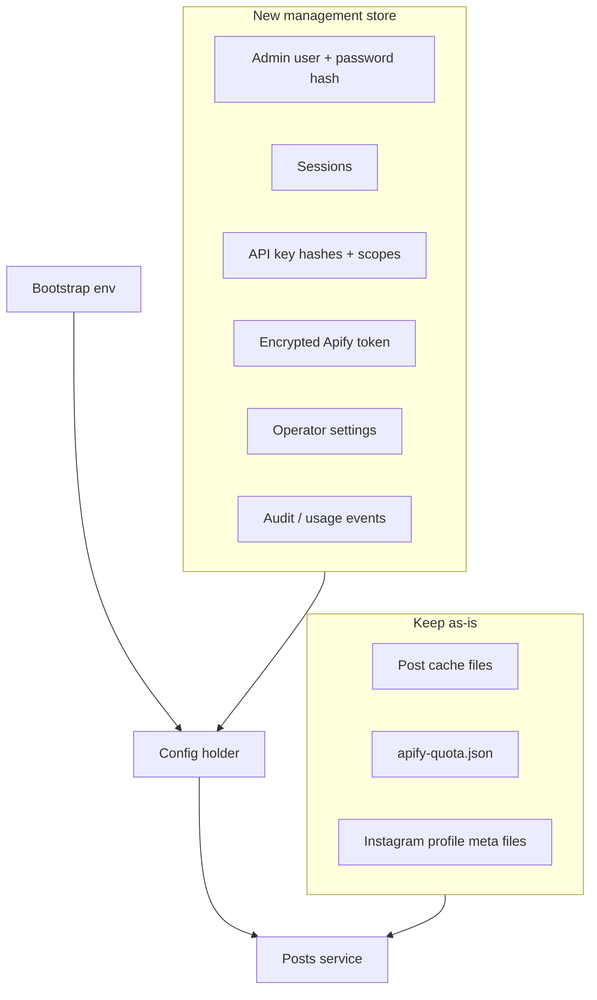
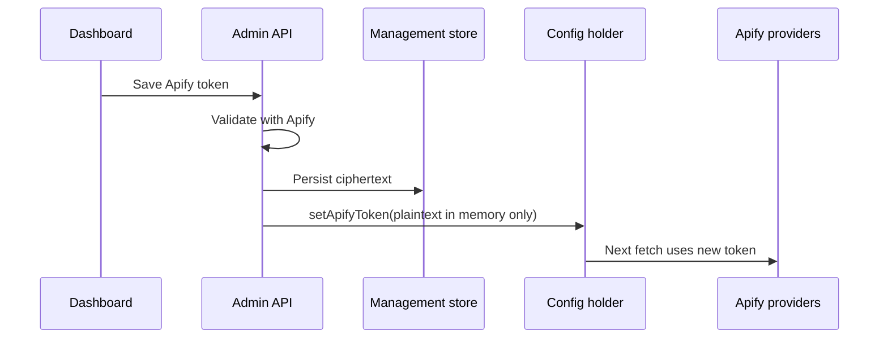

# Storage and configuration design

**Phase:** 7A design only  
**Related:** [ADR-006](./decisions/ADR-006-management-storage.md), [ADR-004](./decisions/ADR-004-apify-token.md), [ADR-005](./decisions/ADR-005-api-keys.md), [ADR-008](./decisions/ADR-008-usage-and-quota.md)

---

## 1. Current persistence (verified)

| Data | Location | Format | Notes |
| --- | --- | --- | --- |
| Post cache | `CACHE_DIR/<sha1(key)>.json` | JSON | Memory + disk; never overwrite with empty |
| Apify quota | `CACHE_DIR/apify-quota.json` | `{ schemaVersion, utcDate, consumed }` | Single-process; fail closed if corrupt |
| Instagram profile meta | `CACHE_DIR/instagram-profiles/` (via store) | JSON | Separate TTL from posts |
| Config / secrets | Process env (`.env` / Compose) | Strings | Loaded once at startup |
| API keys | Env `API_KEYS` | Plaintext secrets in env | Hashed only in memory for verify |

**Do not migrate or delete** existing cache/quota in 7A–7C without explicit operator action.

---

## 2. Design principle: split stores by purpose

One mechanism does **not** need to hold all data.

---

## 3. Technology comparison

| Option | Simplicity | Concurrency | Encryption story | Fits zero-deps rule | Verdict |
| --- | --- | --- | --- | --- | --- |
| **A. Existing files only** (extend JSON files) | High | Process queue / atomic rename | App-level AES for secrets file | Preserves zero npm deps | Viable MVP fallback |
| **B. SQLite** for management | Medium | Strong for single writer | Secrets as ciphertext columns; posts stay files | Needs engine bump (`node:sqlite`) or npm driver | **Recommended** |
| **C. PostgreSQL / Redis** | Low for self-host | High | Mature | Overkill for single instance | Rejected for MVP |

### Recommendation

1. **Keep** post cache + quota + Instagram profile files exactly as today.
2. **Add** a management database file on the same volume, e.g. `/data/management/app.sqlite` (path configurable).
3. Prefer **Node.js built-in `node:sqlite`** after raising engines to a version where it is acceptable for production **or** `better-sqlite3` if built-in remains experimental — **OPEN** (owner approval on engines/deps). See ADR-006.
4. Until SQLite lands, an **encrypted JSON document** store with atomic replace is an acceptable interim in 7C if needed to ship admin features without blocking.

---

## 4. Management schema (logical)

Not implemented in 7A — logical model for 7C:

| Entity | Fields (conceptual) |
| --- | --- |
| `admin_user` | id, username, password_hash, kdf_params, created_at, updated_at |
| `bootstrap_state` | setup_completed_at, setup_token_hash, setup_token_expires_at |
| `session` | id_hash, admin_id, created_at, expires_at, last_seen_at, user_agent_hash |
| `api_key` | id, name, key_hash, created_at, revoked_at, last_used_at |
| `api_key_scope` | api_key_id, cache_key (`cern` / `instagram:nasa`) |
| `provider_secret` | kind=`apify`, ciphertext, iv, key_version, last_validated_at, status |
| `setting` | key, value_json, updated_at |
| `audit_event` | id, at, actor, action, meta_json (no secrets) |
| `usage_counter` | day, name, count |

Migrations: numbered SQL or versioned document schema; apply on startup before listen.

---

## 5. Encryption at rest (Apify token and similar)

**Recommended:** Application-managed envelope encryption.

- Operator supplies `DATA_ENCRYPTION_KEY` (32-byte high entropy) via env/Compose secret — **not** stored in the DB.
- Encrypt token with AES-256-GCM; store ciphertext + IV/nonce + key version.
- Rotation: support `DATA_ENCRYPTION_KEY_PREVIOUS` briefly for re-encrypt jobs.

**Why not “only env” forever:** Dashboard must set/replace token without redeploy; env-only cannot hot-update safely.

**Why not store plaintext in SQLite:** Volume backups and debug copies would leak.

**Backup warning:** DB backups contain ciphertext; anyone with **both** backup and `DATA_ENCRYPTION_KEY` can decrypt. Document key escrow for the operator.

---

## 6. Config precedence

| Key | Precedence (high → low) |
| --- | --- |
| Apify token | Management store → env `APIFY_TOKEN` → empty |
| API keys | Management store active keys **union** env keys during migration window → later store-only option |
| Allowlists / warm lists | Management settings override env when `settings_source=db` flag set |
| `CACHE_DIR`, ports, encryption key | Env / Compose only |

Document in UI which knobs need restart.

---

## 7. Runtime activation (no naïve `.env` rewrite)

- Providers read token via `config.apify.token` getter or shared holder object mutated under mutex.
- Do **not** rely on rewriting `.env` for running processes.
- Optional: write a non-secret status file for operators; never write raw token to a world-readable path.

---

## 8. Cache / quota compatibility

| Requirement | Approach |
| --- | --- |
| Existing Facebook cache keys | Unchanged (`cern`) |
| Existing Instagram keys | Unchanged (`instagram:nasa`) |
| Quota file | Unchanged schema; admin API read-only status |
| Force refresh | Calls existing `refresh()`; still `reserve()` first |
| Purge cache entry | Delete specific hash file + memory entry; do not touch quota |
| Single replica | Remains mandatory for filesystem quota |

---

## 9. File permissions (Docker)

- Volume `/data` owned by runtime user (`node`, uid 1000 in current Dockerfile).
- Management DB mode `0600`; directory `0700` where feasible.
- Bootstrap token file (if used) `0600`, deleted or truncated after successful setup.

---

## 10. Backup and restore

**Backup**

1. Stop or quiesce writes (brief) for consistency.
2. Copy `CACHE_DIR` (posts + quota + IG profiles) and management DB.
3. Separately escrow `DATA_ENCRYPTION_KEY` and TLS material — **not** inside the same unencrypted tarball if possible.

**Restore**

1. Restore files to volume paths.
2. Start single API replica.
3. Verify `/health`, admin login, quota date, sample cache GET.

**Migration impact:** Adding management DB is additive. Env-based deploys keep working. No automatic deletion of post cache.

---

## 11. Windows / local dev

- File paths via `path.join`; SQLite path under `./data/management`.
- Same atomic rename patterns already used on Windows in tests.
- Dashboard and API may run as two Node processes locally with proxy or Next rewrites to API.
